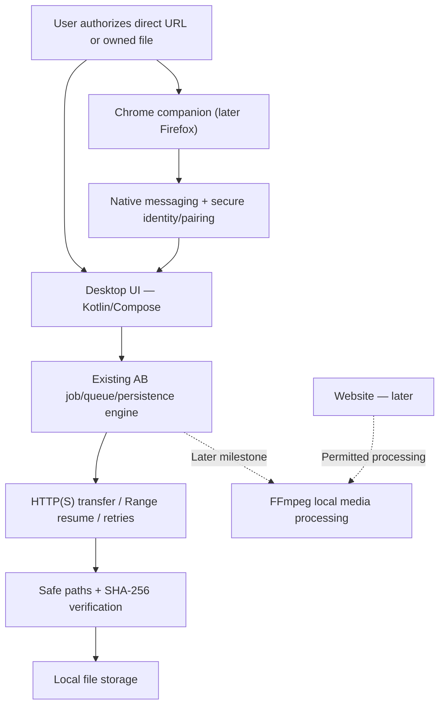

# DOWNLOADER — COMPLETE PROJECT KNOWLEDGE BASE AND CHAT ARCHIVE

> **Assembled:** 2026-11-16. **Canonical repository:** https://github.com/kawakaze430/Downloader-  
> **Use:** handoff to new ChatGPT/Codex sessions, developers, researchers and maintainers.  
> **Includes:** historical chat decisions, the complete snapshots of 23 current project documents, architecture diagrams, roadmap and feature tables, engineering audit, study repositories, benchmark references, blockers, release gates and a link index.  
> **Caveat:** This is a structured reconstruction of public conversation plus exact GitHub document snapshots; it is **not** a verbatim ChatGPT export. No concealed private reasoning, unreadable attachment contents or unverified tests are invented. The underlying source documents may evolve after this archive.

## The project in 90 seconds

**Goal:** Build an independently branded, robust, desktop-first and local-first download manager for authorized content, with a secure Chrome companion, later Firefox, local media processing and a modern website. Competitors are benchmarks for capabilities and user experience, not a verified ranking of “#1”.

**Exactly two primary candidates (conditional; not yet imported):**

1. [AB Download Manager](https://github.com/amir1376/ab-download-manager) — Kotlin/Compose desktop; pinned research commit `68f0ea6e8ba5cbeb02c92342cd3bf7475378ae68`.
2. [AB Browser Integration](https://github.com/amir1376/ab-download-manager-browser-integration) — Chrome Manifest V3 and Firefox integration; pinned research commit `bf6811dd8a3ee2b47b94d70e13c2c7e70be7be05`.

There are 15 additional study repositories. Study or selectively adapt them only after security, licensing, maintenance and duplication reviews. **One final product monorepo**, not an indiscriminate copy of 17 projects.

**Historical implementation truth:** Initial documentation + an original Python HTTP/HTTPS deterministic fixture, regression tests and CI workflow. The last reported local fixture run passed **14 tests**; no integrated first-party desktop downloader, extension handoff, hosted service or release was yet built. Never confuse candidate upstream features with features actually implemented in this repo.

**Known gates:** Owner approval for foundation/source import, original project licensing, Windows+Chrome initial scope; complete Gradle/JDK 25 environment check; upstream extension TypeScript repair; native-messaging/localhost authentication and pairing; 2 reported high-severity dependency advisories to triage; bundled third-party provenance.

## What to read first

1. [New-chat/Codex resume prompt](https://github.com/kawakaze430/Downloader-/blob/main/docs/context-archive/RESUME_PROMPT.md)
2. [Chronological conversation history](https://github.com/kawakaze430/Downloader-/blob/main/docs/context-archive/CHAT_HISTORY.md)
3. [Current agent instructions](https://github.com/kawakaze430/Downloader-/blob/main/AGENTS.md)
4. [Current decisions and owner gates](https://github.com/kawakaze430/Downloader-/blob/main/docs/DECISIONS.md)
5. [Current ordered checklist](https://github.com/kawakaze430/Downloader-/blob/main/docs/IMPLEMENTATION_CHECKLIST.md)
6. [M0 evidence and blockers](https://github.com/kawakaze430/Downloader-/blob/main/docs/M0_AUDIT.md)
7. [17-repository matrix](https://github.com/kawakaze430/Downloader-/blob/main/docs/REUSE_DECISION_MATRIX.md)

## Planned architecture chart (conceptual, not a claim of implementation)

## Priority delivery chart

| Workstream | Goal | State at historical archive |
| --- | --- | --- |
| G — Decisions | brand, license, source approval, Windows/Chrome scope | owner decisions pending |
| M0 — Foundation | audit, verified builds, security model, licensing, fixtures | in progress |
| M1 — Desktop | one real verified authorized HTTPS download + resume, retry, checksum, persistence | not integrated |
| M2 — Chrome | one verified secure Chrome-to-desktop job | not integrated |
| M3 — Media | authorized conversion / formats / subtitles | future |
| M4 — Website | responsive UI and optional hosted services | future |
| M5 — Release | CI, signing, installers, updates, security gates | future |
| M6 — Advantage | automation, scheduling improvements, plugins, UX | future |

## Research links and benchmarks

| Type | Repository or product | URL |
| --- | --- | --- |
| Desktop primary | AB Download Manager | https://github.com/amir1376/ab-download-manager |
| Extension primary | AB Browser Integration | https://github.com/amir1376/ab-download-manager-browser-integration |
| Website study | ReClip | https://github.com/averygan/reclip |
| Extension study | MediaGrabber | https://github.com/miroshArtem/MediaGrabber |
| HLS study | HLS Downloader | https://github.com/puemos/hls-downloader |
| Desktop study | Parabolic | https://github.com/NickvisionApps/Parabolic |
| Media engine | FFmpeg | https://github.com/FFmpeg/FFmpeg |
| Optional permitted-source connector | yt-dlp | https://github.com/yt-dlp/yt-dlp |
| Engine study | Gopeed | https://github.com/GopeedLab/gopeed |
| Desktop UX study | Motrix | https://github.com/agalwood/Motrix |
| Download protocol study | aria2 | https://github.com/aria2/aria2 |
| Web UX study | Cobalt | https://github.com/imputnet/cobalt |
| UI/queue study | MeTube | https://github.com/alexta69/metube |
| Automation study | Pinchflat | https://github.com/kieraneglin/pinchflat |
| Library study | Tube Archivist | https://github.com/tubearchivist/tubearchivist |
| Fullstack study | YouTubeDL-Material | https://github.com/Tzahi12345/YoutubeDL-Material |
| Archived UI study | yt-dlp-web-ui | https://github.com/marcopiovanello/yt-dlp-web-ui |
| Commercial benchmark | 4K Video Downloader Plus | https://www.4kdownload.com/products/videodownloader-42 |
| Commercial benchmark | Internet Download Manager | https://www.internetdownloadmanager.com/ |
| Extension benchmark | Video DownloadHelper | https://www.downloadhelper.net/ |
| Web benchmark | Cobalt | https://cobalt.tools/ |
| Manager benchmark | JDownloader | https://jdownloader.org/ |

## Historical links to work already performed

- [First contributor docs commit 51022e8](https://github.com/kawakaze430/Downloader-/commit/51022e8f6440c3dabba46179c5642a7c8c3d3a3e)
- [Study inventory commit 3509d51](https://github.com/kawakaze430/Downloader-/commit/3509d5158630416b656508e2fe35a57265148752)
- [M0 foundation engineering commit 042671dc](https://github.com/kawakaze430/Downloader-/commit/042671dc72c8a9b3032e19419d550bec6f518342)
- [Issues #1](https://github.com/kawakaze430/Downloader-/issues/1), [#2](https://github.com/kawakaze430/Downloader-/issues/2), [#3](https://github.com/kawakaze430/Downloader-/issues/3) — original M0 contributor tasks.
- [Issue #4](https://github.com/kawakaze430/Downloader-/issues/4) — Gradle/JDK; [#5](https://github.com/kawakaze430/Downloader-/issues/5) — TypeScript; [#6](https://github.com/kawakaze430/Downloader-/issues/6) — secure extension pairing.
- **Old project link retained for provenance:** https://github.com/rejoansardar620-lang/Downloader-. Current writes target `kawakaze430/Downloader-`.

## Provenance, accuracy and privacy

This snapshot includes the unmodified source texts of 23 existing documentation/agent/test-guidance files, with the original blob IDs and source paths in each chapter. Technical findings, releases, starred counts and PR statuses are historical. The previous chat said 0 PRs at one point; this document does not assert that is still true.

The conversation history is a structured archive of user messages and visible assistant decisions; it cannot substitute for a platform export of the exact chat. A TXT attachment named `Create Video Downloader Extension.txt` was visible but returned no readable contents from the file reader, so nothing from that file is invented here. Publishing to a public repo is deliberate; no credentials or private internal reasoning are included.

## SOURCE DOCUMENT SNAPSHOTS — exact project text as fetched

The following three sections contain all 23 archived GitHub sources verbatim, including source tables, commands, diagrams where present, and URLs. Refer to live source files for subsequent changes.

---

# ARCHIVED SOURCE PART 1 OF 3

# SOURCE DOCUMENT SNAPSHOT — Part 1 of 3

Dated: 2026-11-16. Original documents reproduced from GitHub. These are immutable historical snapshots, not live current-state claims.

---

# SOURCE 1: README.md

Original: https://github.com/kawakaze430/Downloader-/blob/main/README.md  
Blob: `1b10997770d90d695a2f1f9eb5c141ab65f3ad20`

<!-- BEGIN README.md -->

# Downloader — product blueprint

> **Status: planning and M0 engineering audit in progress. The upstream browser-extension candidate builds, but no Downloader application has been imported, implemented or released here yet.**

This is the public collaboration hub for an independently branded, cross-platform **download manager and authorized media-processing platform**. The ambition is to build a credible competitor to established desktop download managers, video downloaders, and browser media tools—not merely a page that accepts a YouTube URL.

The product name, software license, commercial model, and final architecture have **not** been approved yet. "Downloader" is a working name. The project owner controls this repository; contributors retain any rights not transferred or licensed under an agreed contribution policy.

## North star

Create one cohesive experience across:

1. **Desktop** — the flagship application for reliable local downloads, pause/resume, queues, scheduling, file organization, and media conversion.
2. **Browser extension** — discover permitted downloads and hand jobs securely to the desktop application.
3. **Website** — introduce the product and, in a later milestone, offer a secure browser-based interface for user-owned or explicitly downloadable media.
4. **Shared engine and optional services** — reusable jobs, format discovery, media processing, authentication where needed, and diagnostics.

We benchmark **4K Video Downloader Plus** for video workflows, **Internet Download Manager** for download reliability, **Video DownloadHelper** for browser integration, **JDownloader** for automation, and **Cobalt** for web usability. None has been independently established as the single worldwide "#1" across all categories. See [market analysis](docs/COMPETITOR_BENCHMARK.md).

## Project status

| Area | Current status | First next step |
| --- | --- | --- |
| Vision, scope, roadmap | Documented; review requested | Agree on priorities |
| Repository/license audit | 17-repository source triage complete; dependency-level audit open | Unblock desktop build; review permissions, SBOM and NOTICE obligations |
| Desktop application | Not implemented | Evaluate AB Download Manager foundation |
| Browser extension | Not implemented | Evaluate AB Browser Integration foundation |
| Website/download UI | Not implemented | Design original UI; ReClip is a UX reference only pending SSRF/security review |
| Media processing | Not implemented | Verify FFmpeg integration and permitted-source policy |
| Automated tests, CI and releases | 14 local fixture tests pass; minimal PR/manual fixture CI added; no app CI or releases | Verify GitHub workflow and develop product test gates |

Do not interpret the existence of a feature in an upstream project as an implemented feature **here**.

## Start here

- [New contributor quick start](docs/START_HERE.md)
- [Complete ordered implementation checklist](docs/IMPLEMENTATION_CHECKLIST.md) — milestones, dependencies, release gates and blockers
- [M0 engineering audit](docs/M0_AUDIT.md) — source pins, actual Chrome build result, reuse matrix, security findings and handoff
- [Verified 17-repository reuse matrix](docs/REUSE_DECISION_MATRIX.md) — candidates, licenses, exact source commits and decisions
- [Build-start engineering plan](docs/BUILD_START_PLAN.md) — original code inventory, threat model, architecture and M0/M1/M2 gates
- [Local direct-download fixture](tools/fixtures/README.md) — original dependency-free HTTP/optional HTTPS test server; 14 passing tests, no paid network calls
- [Project vision and users](docs/PRODUCT_VISION.md)
- [Complete feature inventory and acceptance criteria](docs/FEATURE_MATRIX.md)
- [Reference repositories, licenses and reuse strategy](docs/REFERENCE_REPOSITORIES.md)
- [Complete study repository list (TXT)](docs/STUDY_REPOSITORIES.txt) — all 17 previously suggested open-source projects, categories and study order
- [Proposed system architecture](docs/ARCHITECTURE.md)
- [Milestones and definition of done](docs/ROADMAP.md)
- [Competitor benchmarks](docs/COMPETITOR_BENCHMARK.md)
- [Legal, copyright, privacy and security guardrails](docs/LEGAL_SECURITY.md)
- [Development and testing setup](docs/DEVELOPMENT_SETUP.md)
- [Codex/cloud workflow and credit-saving instructions](docs/CODEX_WORKFLOW.md)
- [Open architectural decisions](docs/DECISIONS.md)
- [How to contribute](CONTRIBUTING.md)
- [AI contributor instructions](AGENTS.md)

## Recommended starting points (not imported)

| Purpose | Candidate | Why |
| --- | --- | --- |
| Main desktop starting point | [AB Download Manager](https://github.com/amir1376/ab-download-manager) | Mature open-source download management; Apache-2.0 |
| Browser companion | [AB browser integration](https://github.com/amir1376/ab-download-manager-browser-integration) | Already works with AB application; Apache-2.0 |
| Web-download experience (reference only) | [ReClip](https://github.com/averygan/reclip) | MIT Flask/JS UX patterns; arbitrary remote URL handling is not a secure foundation for a hosted service |
| Media discovery | [MediaGrabber](https://github.com/miroshArtem/MediaGrabber) and [HLS Downloader](https://github.com/puemos/hls-downloader) | Extension architecture and non-DRM streams; both MIT |
| Media operations | [FFmpeg](https://github.com/FFmpeg/FFmpeg) | Conversion/remuxing with build-dependent licenses |
| Optional extraction | [yt-dlp](https://github.com/yt-dlp/yt-dlp) | For sources and uses that permit downloading; check bundled licenses |

**Important:** These are research inputs, not automatically approved dependencies. The software must not facilitate unauthorized access, DRM circumvention, or prohibited copying.

## Working rules

- **Reuse verified, appropriately licensed implementations.** Do not spend time rebuilding existing queues, scheduling, browser handoff, FFmpeg, or installers without a demonstrated need.
- **Keep one product repository** with modular packages rather than pasting unrelated projects together.
- **Implement in verified increments.** Every feature needs tests, meaningful errors and a clear status.
- **Privacy and safety first.** Protect user files, download permissions, cookies, local helper APIs and cloud services.
- **Do not promise universal website support.** Compatibility changes, permissions and platform policies limit availability.

## Contributing right now

The first milestone is an **evidence-backed repository and license audit**, not an entire product rewrite. Choose an issue, read [CONTRIBUTING.md](CONTRIBUTING.md), and propose improvements via a focused PR. The owner must select a software license and contribution policy before accepting substantial new application code.

## Links and scope

- Project: https://github.com/rejoansardar620-lang/Downloader-
- Research snapshot: **15 November 2026**; upstream capabilities and licenses must be rechecked before adoption.
- This repository does not contain source code from any reference project at this stage.

<!-- END README.md -->

---

# SOURCE 2: AGENTS.md

Original: https://github.com/kawakaze430/Downloader-/blob/main/AGENTS.md  
Blob: `baad5e3d6e5d99fa56103678a1b329d87812fc22`

<!-- BEGIN AGENTS.md -->

# Instructions for coding agents and AI contributors

You are working on **Downloader**, a planned desktop-first download manager, browser companion and authorized media-processing platform. Read this file and the linked product documents before changing code.

## Source of truth, in order

1. [Legal and security requirements](docs/LEGAL_SECURITY.md).
2. [Decisions and unresolved owner choices](docs/DECISIONS.md).
3. [Ordered implementation checklist](docs/IMPLEMENTATION_CHECKLIST.md), [product vision](docs/PRODUCT_VISION.md) and [feature matrix](docs/FEATURE_MATRIX.md).
4. [Architecture](docs/ARCHITECTURE.md) and [roadmap](docs/ROADMAP.md).
5. Existing source files, tests and upstream documentation once code is imported.

If sources disagree, flag the conflict and request a decision. Do not invent requirements or treat proposed architecture as implemented.

## Mandatory workflow

1. **Inspect before editing.** Check branch, worktree, related docs, existing implementations, dependency licenses and tests. Preserve unrelated changes.
2. **Classify the request** as investigation, audit, documentation, implementation, testing or deployment.
3. **Reuse before building.** For each proposed feature, state whether it already exists, needs adaptation, or is genuinely missing. Check license/security compatibility.
4. **Make a narrow plan** with acceptance criteria and expected tests. Do not attempt the whole roadmap in one task.
5. **Implement only authorized scope**, using clear interfaces and least-privilege access.
6. **Verify** with relevant tests/builds and a real, permitted fixture. Separate observed results from assumptions.
7. **Report** files changed, tests run, remaining blockers and updated feature status.

## Cost control for Codex Cloud

- First task: **audit and gap matrix only**. No bulk code import or large rewrite without owner approval.
- Prioritize the smallest end-to-end vertical slice, then expand.
- Do not regenerate working code merely to change framework or style.
- Cache dependencies in CI, use targeted tests and avoid expensive video downloads in routine runs.
- Prefer small deterministic test media and mock adapters; run real-network compatibility tests separately and with permission.
- Do not provision cloud servers, enable paid services or deploy publicly without explicit owner approval.
- Commit meaningful progress frequently; never rely on disposable task storage for critical work.

## Safety and correctness

- Do not circumvent DRM, paywalls, authentication, geo-controls, or copyright restrictions.
- Respect YouTube and other platform policies; official APIs do not generally authorize raw media downloading.
- Public Chrome extension releases must comply with Chrome Web Store policies (including YouTube restrictions).
- Never log or commit cookies, passwords, tokens, private URLs, user media, secrets or personal identifiers.
- Validate remote URLs and redirects; block private network destinations and metadata endpoints; limit resource usage.
- Protect local companion APIs against arbitrary websites and cross-origin abuse; use pairing, origin checks and authentication.
- Sandbox media parsing/transcoding and use trusted, verified dependencies.
- Preserve original copyright and license notices for reused code; use the approved project license only after owner decision.

## Project maturity

As of the first [M0 audit](docs/M0_AUDIT.md) there is **no application implementation** here. The pinned upstream Chrome extension builds, but no product runtime was imported or tested end to end. A documented upstream feature is **not** an implemented local feature. Do not mark any item Complete until the defined evidence is recorded.

## Suggested first deliverables

1. Upstream audit including license/SPDX/NOTICE, dependency health and tested builds.
2. Decision record for base application and shared engine.
3. Minimal app + extension integration with a user-authorized direct-download test fixture.
4. Automated tests, packaging and documentation for that slice.

Follow [CONTRIBUTING.md](CONTRIBUTING.md) for human review and PR expectations.

<!-- END AGENTS.md -->

---

# SOURCE 3: docs/START_HERE.md

Original: https://github.com/kawakaze430/Downloader-/blob/main/docs/START_HERE.md  
Blob: `290d18988079c51f17b5aa23fa3620c35c3d7a5a`

<!-- BEGIN docs/START_HERE.md -->

# Start here: new developer onboarding

**Current status:** The repository contains a plan and contributor instructions, not a running downloader.

## Understand the product in 10 minutes

1. [README](../README.md) — overview and current implementation status.
2. [Product vision](PRODUCT_VISION.md) — users, competition and product boundaries.
3. [Feature matrix](FEATURE_MATRIX.md) — exact capabilities, priority and acceptance.
4. [Ordered implementation checklist](IMPLEMENTATION_CHECKLIST.md) — exact task order and stage gates.
5. [Architecture](ARCHITECTURE.md) — intended components and interaction.
6. [Roadmap](ROADMAP.md) — what to build first.
7. [Reference projects](REFERENCE_REPOSITORIES.md) — what to evaluate and reuse.
8. [Legal/security](LEGAL_SECURITY.md) — non-negotiable safeguards.
9. [Codex workflow](CODEX_WORKFLOW.md) — budget-conscious AI implementation.
10. [Verified 17-source research matrix](REUSE_DECISION_MATRIX.md) — exactly two recommended foundations; all commit pins and licensing warnings.
11. [Build-start and security execution plan](BUILD_START_PLAN.md) — source inventory, M0 blockers, staged M1/M2 acceptance gates.

## First contribution: repository audit

**Expected output, before any large import:**

- Pin a commit/tag for each proposed source project.
- Record language, frameworks, build instructions, release activity and tests.
- Verify licenses including transitive libraries, bundled tools and NOTICE obligations.
- Build and test the proposed base in an isolated environment; capture real results.
- Map each feature to **implemented upstream / partially implemented / missing**, and separately to **implemented here / unimplemented**.
- Compare integration costs, security risks, package sizes and maintenance burden.
- Recommend one base app and extension with a small working integration target.

Use the issue template. Put audit results in a PR; avoid copying upstream trees before approval.

**Current M0 evidence (15 November 2026):** The 17-source triage and two-foundation recommendation have been documented; the original Python HTTP/HTTPS fixture has **14 passing local tests** and a small fixture-only CI workflow. The upstream Chrome/Firefox bundles compile but fail independent TypeScript checks; desktop Gradle bootstrap is network-blocked. See [M0_AUDIT.md](M0_AUDIT.md). These results do not constitute a working downloader.

## Owner decisions needed before substantial code imports

1. Product/brand name and trademark checks.
2. Intended distribution: open-source, source-available, or proprietary.
3. Project license and contributor terms (no LICENSE has been chosen).
4. Initial supported OS/browser pair (recommend Windows + Chrome, then Linux/Firefox).
5. Whether the initial web app supports uploads, authorized direct URLs, or only marketing.
6. Whether any third-party source requires written authorization before downloads.

## Suggested first runnable demonstration

With permission to implement, show a Chrome extension sending an **authorized HTTPS file URL** to a desktop app. The app downloads with progress, pause/resume where the server supports range requests, checksum verification, and restart recovery. A short test fixture proves the flow. This validates the hardest shared integration without relying on YouTube compatibility.

## Common mistakes to avoid

- Calling a planned feature "implemented."
- Importing AGPL/GPL code into a closed-source product without resolving obligations.
- Copying user credentials into test fixtures or CI.
- Building the whole stack before validating one application-extension bridge.
- Depending on scraping or external network behavior for the entire test suite.

<!-- END docs/START_HERE.md -->

---

# SOURCE 4: docs/STUDY_REPOSITORIES.txt

Original: https://github.com/kawakaze430/Downloader-/blob/main/docs/STUDY_REPOSITORIES.txt  
Blob: `3a5aa76a011848b197fcc082e917c3c1322b87c1`

<!-- BEGIN docs/STUDY_REPOSITORIES.txt -->

DOWNLOADER PROJECT - COMPLETE OPEN-SOURCE STUDY REPOSITORY LIST
================================================================
Research inventory originally prepared: 13 November 2026
List compiled for contributors: 15 November 2026
Project: https://github.com/rejoansardar620-lang/Downloader-
Source of this list: docs/REFERENCE_REPOSITORIES.md and docs/M0_AUDIT.md

PURPOSE
-------
Build our independently branded download manager with:
(1) Desktop app, (2) Chrome/Firefox extension, (3) website,
(4) authorized media tools, (5) optional advanced automation.
Study and reuse existing code only when verified and license-compatible.
This is a STUDY LIST, not a list of projects already imported or approved.
Root licenses below are historical/reported and MUST be rechecked, along
with all transitive dependencies and bundled binaries, before code reuse.

CATEGORY A - PRIMARY REUSE / INTEGRATION CANDIDATES (8)
-------------------------------------------------------

01. AB Download Manager
    URL: https://github.com/amir1376/ab-download-manager
    Reported license: Apache-2.0
    Role: PRIMARY DESKTOP FOUNDATION (provisional).
    Study: Kotlin/Compose app; direct downloads; queues, retries,
      scheduling, persistence, pause/resume, download engine, UI.
    Evidence: Source checked at commit
      68f0ea6e8ba5cbeb02c92342cd3bf7475378ae68.
    Status: Partial M0 audit; desktop Gradle bootstrap blocked by
      environment network access (see GitHub issue #4).
    Do not rewrite: Existing transfer engine until tested and proven missing.

02. AB Download Manager Browser Integration
    URL: https://github.com/amir1376/ab-download-manager-browser-integration
    Reported license: Apache-2.0
    Role: PRIMARY BROWSER EXTENSION FOUNDATION (provisional).
    Study: Chrome MV3, Firefox, native messaging, desktop localhost
      handoff, context menus, download capture, HLS detection.
    Evidence: Source checked at commit
      bf6811dd8a3ee2b47b94d70e13c2c7e70be7be05.
    Status: Chrome and Firefox bundler builds PASS; standalone TypeScript
      check FAIL. See issue #5. Security hardening needed (issue #6).

03. ReClip
    URL: https://github.com/averygan/reclip
    Reported license: MIT
    Role: Possible lightweight website/UI starting point.
    Study: Flask/JavaScript interface, format/quality options, batches,
      user experience, safe server architecture.
    Status: Candidate only; source/dependency/security audit pending.

04. MediaGrabber
    URL: https://github.com/miroshArtem/MediaGrabber
    Reported license: MIT
    Role: Selective extension media-discovery reference.
    Study: Manifest V3, media link discovery, helper communication.
    Status: Audit pending. Existing AB extension already detects HLS;
      do not duplicate its logic without a verified gap.

05. HLS Downloader
    URL: https://github.com/puemos/hls-downloader
    Reported license: MIT
    Role: Selective authorized non-DRM HLS processing reference.
    Study: Stream manifests, local processing, ffmpeg.wasm tradeoffs.
    Status: Audit pending. Do not bypass access controls or DRM.

06. Parabolic
    URL: https://github.com/NickvisionApps/Parabolic
    Reported license: MIT in original inventory (reverify).
    Role: Alternative desktop video/audio workflow candidate.
    Study: Quality/format selection, UX, batch operations,
      Linux/Windows support and dependency costs.
    Status: Compare against AB before selecting a second desktop base.

07. FFmpeg
    URL: https://github.com/FFmpeg/FFmpeg
    Reported license: LGPL or GPL depending on build/configuration.
    Role: Media conversion/remuxing/probing backend.
    Study: MP4/MKV/WebM, audio extraction, subtitles, metadata,
      output validation, resource limits, binary packaging.
    Status: Proposed dependency; specific build flags and licenses unverified.

08. yt-dlp
    URL: https://github.com/yt-dlp/yt-dlp
    Reported license: Core Unlicense; bundled components vary.
    Role: OPTIONAL connector for sources where downloading is permitted.
    Study: Extractor interfaces, metadata, format reporting, update strategy.
    Status: Restricted research candidate, not default public-site support.

CATEGORY B - STUDY FOR DESIGN / FEATURES, NOT AUTOMATIC CODE IMPORT (9)
----------------------------------------------------------------------

09. Gopeed
    URL: https://github.com/GopeedLab/gopeed
    Reported license: GPL-3.0
    Study: Cross-platform engine, modular downloader, extensions,
      API/CLI, automation, design tradeoffs.
    Restriction: GPL license review before any reuse.

10. Motrix
    URL: https://github.com/agalwood/Motrix
    Reported license: Main source MIT; bundled aria2 GPL-licensed.
    Study: Desktop UI, task management, install/update experience,
      aria2 integration, notification and permissions.
    Restriction: Audit entire distribution, not just top-level MIT license.

11. aria2
    URL: https://github.com/aria2/aria2
    Reported license: GPL-2.0
    Study: Segmented downloading, resume, HTTP/FTP/BitTorrent support,
      JSON-RPC, concurrency and error handling.
    Restriction: GPL compatibility required if distributing linked/bundled code.

12. Cobalt
    URL: https://github.com/imputnet/cobalt
    Reported license: AGPL-3.0
    Study: Clean web media UX, API/backend separation, privacy,
      responsive error messages.
    Restriction: Reference only until AGPL/network obligations reviewed.

13. MeTube
    URL: https://github.com/alexta69/metube
    Reported license: AGPL-3.0
    Study: Queue, self-hosted downloads, format choices,
      playlist/channel workflows, task progress.
    Restriction: Reference only until AGPL obligations reviewed.

14. Pinchflat
    URL: https://github.com/kieraneglin/pinchflat
    Reported license: AGPL-3.0
    Study: Recurring scheduled tasks, library names,
      presets, configuration and automation.
    Restriction: Reference only until AGPL obligations reviewed.

15. Tube Archivist
    URL: https://github.com/tubearchivist/tubearchivist
    Reported license: GPL-3.0
    Study: Media library, search, tagging, organization, indexing,
      long-running worker/service design.
    Restriction: GPL compatibility review before any reuse.

16. YoutubeDL-Material
    URL: https://github.com/Tzahi12345/YoutubeDL-Material
    Reported license: MIT
    Study: Full-stack web UI, download queues, user settings,
      multi-user service patterns.
    Restriction: Check maintenance, dependencies and security carefully.

17. yt-dlp-web-ui
    URL: https://github.com/marcopiovanello/yt-dlp-web-ui
    Reported license: GPL-3.0; recorded as archived October 2026.
    Study: RPC and web/worker communication patterns.
    Restriction: Not recommended as primary maintained foundation;
      verify archived status and GPL before any reuse.

COMPETITOR PRODUCTS TO BENCHMARK (NOT REUSABLE SOURCE REPOS)
-----------------------------------------------------------
A. 4K Video Downloader Plus - https://www.4kdownload.com/
   Study: Video workflows, format selection, playlists, subtitles.
B. Internet Download Manager (IDM) - https://www.internetdownloadmanager.com/
   Study: Reliability, browser capture, resume, speed and scheduling.
C. Video DownloadHelper - https://www.downloadhelper.net/
   Study: Extension UX, discoverability, companion architecture,
     browser-store requirements. Notably Chrome store limits YouTube support.
D. JDownloader 2 - https://jdownloader.org/
   Study: LinkGrabber, batch workflows, filters, automation.
E. Cobalt - see #12 above.
   Study: Minimal web interface and API UX.

RECOMMENDED STUDY ORDER
-----------------------
PHASE 1  Read docs/M0_AUDIT.md and docs/IMPLEMENTATION_CHECKLIST.md.
PHASE 2  Complete AB desktop build/tests (01) and extension audits (02).
PHASE 3  Compare the AB stack with Parabolic (06); do NOT merge two
         complete desktop applications without a measured reason.
PHASE 4  Audit media choices (07, 08, 04, 05), security and licenses.
PHASE 5  Evaluate website UI candidate ReClip (03) and related examples
         (12, 13, 16, 17) for feature patterns.
PHASE 6  Review downloader engine approaches (09, 10, 11) and
         media-library/automation patterns (14, 15).
PHASE 7  Make a feature-by-feature BUILD vs REUSE vs ADAPT vs DEFER matrix.
PHASE 8  Obtain owner signoff for brand, license, first platform and
         source policy before importing upstream implementations.

SECURITY, RIGHTS AND LICENSE RULES
----------------------------------
- Do not import all 17 repositories into one codebase.
- Prefer one verified core and one compatible extension.
- Preserve copyright, LICENSE and NOTICE requirements.
- GPL/AGPL code is not silently compatible with a proprietary product.
- FFmpeg licensing depends on actual binaries, codecs and build flags.
- Never copy logos, names, trademarks, proprietary assets or credentials.
- Do not bypass DRM, login, paywalls or site terms.
- Test only with user-owned or explicitly permitted download sources.
- Protect localhost APIs against unauthorized webpages and commands.
- No unsupported promises of universal or YouTube downloading.

CURRENT EVIDENCE / HANDOFF
--------------------------
M0 audit: https://github.com/rejoansardar620-lang/Downloader-/blob/main/docs/M0_AUDIT.md
Checklist: https://github.com/rejoansardar620-lang/Downloader-/blob/main/docs/IMPLEMENTATION_CHECKLIST.md
Original reference matrix:
  https://github.com/rejoansardar620-lang/Downloader-/blob/main/docs/REFERENCE_REPOSITORIES.md
Gradle blocker: https://github.com/rejoansardar620-lang/Downloader-/issues/4
TypeScript blocker: https://github.com/rejoansardar620-lang/Downloader-/issues/5
Security pairing: https://github.com/rejoansardar620-lang/Downloader-/issues/6

Last inventory check: 15 November 2026.
This file documents PRIOR SUGGESTIONS, not a new independent license audit.

<!-- END docs/STUDY_REPOSITORIES.txt -->

---

# SOURCE 5: docs/REFERENCE_REPOSITORIES.md

Original: https://github.com/kawakaze430/Downloader-/blob/main/docs/REFERENCE_REPOSITORIES.md  
Blob: `0faab7708d96a21cdcee3fb5084f9082b1cc0b0c`

<!-- BEGIN docs/REFERENCE_REPOSITORIES.md -->

# Open-source landscape and reuse decisions

Snapshot researched on **13 November 2026**. Links, licenses, activity and features can change. **A complete dependency and provenance audit is required before code reuse or distribution.**

## Primary candidates: evaluate for actual integration

| Project | URL | Reported project license | Main value | Initial decision |
| --- | --- | --- | --- | --- |
| AB Download Manager | https://github.com/amir1376/ab-download-manager | Apache-2.0 | Kotlin Multiplatform/Compose desktop manager; acceleration, queues, scheduling | **Preferred desktop base, pending build/security audit** |
| AB browser integration | https://github.com/amir1376/ab-download-manager-browser-integration | Apache-2.0 | Existing extension/desktop handoff, Chrome/Firefox packaging | **Preferred extension base, pending audit** |
| ReClip | https://github.com/averygan/reclip | MIT | Lightweight Flask web media frontend; MP4/MP3, quality and batch | **Candidate website/UI implementation** |
| MediaGrabber | https://github.com/miroshArtem/MediaGrabber | MIT | Manifest V3 detection and native helper reference | **Evaluate selectively**; smaller project, assess tests/security |
| HLS Downloader | https://github.com/puemos/hls-downloader | MIT | Authorized HLS with local ffmpeg.wasm processing | **Evaluate selectively** |
| Parabolic | https://github.com/NickvisionApps/Parabolic | MIT | Desktop video/audio UX, formats and supported OS workflows | **Compare with AB; do not rebuild desktop twice** |
| FFmpeg | https://github.com/FFmpeg/FFmpeg | LGPL/GPL depending on configuration | Media transcoding, remuxing, codecs, metadata | **Use as dependency after binary/license review** |
| yt-dlp | https://github.com/yt-dlp/yt-dlp | Core Unlicense; bundled components differ | Site extractors, format/metadata handling | **Optional, permitted-source plugin only** |

## References: features and patterns, not automatic imports

| Project | URL | License note | What to study |
| --- | --- | --- | --- |
| Gopeed | https://github.com/GopeedLab/gopeed | GPL-3.0 | Cross-platform download engine, extension model, API, CLI, automation |
| Motrix | https://github.com/agalwood/Motrix | Main code MIT; bundled aria2 is GPL-licensed | Desktop UX, plugins, native messaging, SBOM |
| aria2 | https://github.com/aria2/aria2 | GPL-2.0 | Segmented transfers, resume, protocol support, JSON-RPC |
| Cobalt | https://github.com/imputnet/cobalt | AGPL-3.0 | Web UX and API separation |
| MeTube | https://github.com/alexta69/metube | AGPL-3.0 | Format options, queue, playlist/channel subscriptions |
| Pinchflat | https://github.com/kieraneglin/pinchflat | AGPL-3.0 | Download scheduling, media naming, user-defined automation |
| Tube Archivist | https://github.com/tubearchivist/tubearchivist | GPL-3.0 | Media library, search and organizational workflows |
| YoutubeDL-Material | https://github.com/Tzahi12345/YoutubeDL-Material | MIT | Full-stack UI and downloader service; audit older dependencies |
| yt-dlp-web-ui | https://github.com/marcopiovanello/yt-dlp-web-ui | GPL-3.0; archived October 2026 | RPC patterns only; not recommended as primary maintained base |

## Important distinction: source license versus product ownership

- The owner may control the repository, new original code, brand and deployment **without** acquiring exclusive copyright in upstream code.
- **MIT/Apache-2.0** are permissive but still require copyright notices and/or LICENSE/NOTICE preservation; inspect each dependency.
- **GPL/AGPL** often require source-availability obligations under distribution or network use; study as references unless the owner explicitly approves the relevant licensing model.
- FFmpeg builds vary in applicable license conditions; generated binaries, external codecs and nonfree flags must be reviewed.
- A separately installed program, embedded library, linked component and copied source code may create **different** obligations. Obtain appropriate legal review before commercial distribution.
- Branding and logos are independent of code licenses. Do not reuse third-party trademarks or UI assets as our own.

## Audit checklist and evidence format

For **each** adoption candidate:

1. Pin source URL, commit SHA/tag, commit date and maintainer status.
2. Read project license, CONTRIBUTING, NOTICE, third-party notices and build files.
3. Enumerate transitive dependency licenses, bundled executables and media codecs.
4. Identify known vulnerabilities, unsafe install scripts, open network listeners and insecure defaults.
5. Build from source in a clean environment and record exact command, OS, logs and artifacts.
6. Test relevant features with an authorized sample; verify what works instead of repeating README claims.
7. Estimate maintenance burden, compatibility and expected integration changes.
8. Record **reuse / adapt / reference only / reject**, with decision and reviewer.

Suggested report row:

| Component | Ref/commit | Build | License/SBOM | Verified features | Risks | Decision |
| --- | --- | --- | --- | --- | --- | --- |
| Example | To inspect | Not run | Pending | None verified | Pending | Undecided |

## Research sources

Primary project sources are the GitHub repositories above. Product benchmarks and policies are separately linked in [COMPETITOR_BENCHMARK.md](COMPETITOR_BENCHMARK.md) and [LEGAL_SECURITY.md](LEGAL_SECURITY.md).

<!-- END docs/REFERENCE_REPOSITORIES.md -->

---

# SOURCE 6: docs/PRODUCT_VISION.md

Original: https://github.com/kawakaze430/Downloader-/blob/main/docs/PRODUCT_VISION.md  
Blob: `68a34e995b08c3c487ec500b719add25db9469ec`

<!-- BEGIN docs/PRODUCT_VISION.md -->

# Product vision and strategy

## Mission

Create a leading independent **download management and authorized media-processing** system with the reliability of a professional desktop download manager, the convenience of a browser extension, and the approachable experience of a modern website. "No. 1" is an aspiration, **not an achieved ranking or verified market claim**.

## Users and jobs

| User | Primary job | Product response |
| --- | --- | --- |
| Everyday desktop user | Save large permitted files without restarting after interruptions | Reliable queue, progress, resume, integrity checks |
| Creator/editor | Convert and organize their own or licensed media | Local FFmpeg workflows, formats, metadata, subtitles |
| Power user | Manage many legitimate downloads efficiently | Scheduling, batch intake, history, filtering, CLI/API later |
| Browser-first user | Save downloadable files without switching context | Small, privacy-conscious browser companion |
| Self-hosting user (later) | Manage their own permitted file-processing workflow remotely | Authenticated web UI and optional self-hosted service |

## Competitive benchmarks

- **4K Video Downloader Plus:** approachable desktop UX; presets, high-quality formats, subscriptions/playlists when authorized.
- **Internet Download Manager:** robust queueing, segmented transfers, resume/recovery and browser integration.
- **Video DownloadHelper:** discover permitted media from browser pages and provide understandable conversion choices.
- **JDownloader:** batch intake, automation and download management.
- **Cobalt:** simple web interaction and low-friction flows.

These are **feature inspirations**, not permission to copy trademarks, designs, closed-source code or protected content. See [sources and scope](COMPETITOR_BENCHMARK.md).

## Differentiators to prove

1. **Reliability:** recover cleanly from interruption and system restart.
2. **Local-first privacy:** prefer on-device downloading and media processing; clear disclosures when cloud services are used.
3. **One shared experience:** desktop, extension and website use a coherent job model and design language.
4. **Trust:** no misleading buttons, bundled adware, silent credential collection or opaque third-party uploads.
5. **Good defaults:** safe filenames, sensible format presets, helpful errors, minimal permissions.
6. **Developer-ready extensibility:** source adapters and API contracts can evolve independently.

## Business and quality outcomes (targets, not results)

- First public beta: installable desktop application plus working extension for permitted direct downloads, with reproducible automated tests.
- Later product: responsive web UI, localized design, signed releases, auto-updates and supported conversion workflows.
- Measure: completion rate, interruption recovery, median support resolution, download integrity, install success, crash-free sessions and user retention.
- Do not promise universal site support, guaranteed acceleration multipliers, guaranteed 8K, DRM removal or Chrome Web Store approval.

## Non-goals and boundaries

- No access-control, paywall, DRM, authentication or geo-block circumvention.
- No downloading copyrighted YouTube audiovisual media without YouTube permission/appropriate service authorization.
- No bulk hosting of third-party media as a default; minimize server bandwidth/storage costs.
- No rewriting established open-source infrastructure merely for novelty.
- No permanent product branding, license or pricing decision without owner confirmation.

## Product release ordering

1. **Desktop + browser companion** for ordinary authorized file downloads.
2. **Optional local media processing** of uploaded/owned files, with tested format support.
3. **Website** and authenticated remote features where lawful and operationally sustainable.
4. **Advanced automation and integrations** only after reliability, security and license audits pass.

<!-- END docs/PRODUCT_VISION.md -->

---

# SOURCE 7: docs/FEATURE_MATRIX.md

Original: https://github.com/kawakaze430/Downloader-/blob/main/docs/FEATURE_MATRIX.md  
Blob: `5cfb313e0197fa49c172e0cd3980aa6f9cfc0dff`

<!-- BEGIN docs/FEATURE_MATRIX.md -->

# Master feature inventory and acceptance criteria

This is the feature backlog for the intended competitive product. **All application features listed below remain NOT IMPLEMENTED in this repository as of 15 November 2026.** Separately, the repo includes an original deterministic HTTP/HTTPS fixture with 14 passing tests and a fixture-only CI workflow. Neither makes the app features complete. A named upstream library is a candidate to evaluate, **not proof** that our product implements the feature. See the [17-source evidence matrix](REUSE_DECISION_MATRIX.md) and [M0 execution report](BUILD_START_PLAN.md).

Legend: **P0** required for first beta; **P1** important for a competitive 1.x product; **P2** later differentiation. Acceptance criteria below are proposed and may be refined after audit.

## A. Desktop download manager

| ID | Feature | Priority | Candidate | Acceptance target |
| --- | --- | --- | --- | --- |
| D01 | HTTPS direct-file downloads | P0 | AB Download Manager | Download a permitted test file with matching SHA-256 |
| D02 | Real progress, ETA and speed | P0 | AB Download Manager | UI reflects actual transferred bytes; handles unknown length |
| D03 | Pause/resume | P0 | AB Download Manager | Range-capable source resumes without corrupting output; otherwise safe restart |
| D04 | Retry and recovery | P0 | AB Download Manager | Simulated disconnect/restart preserves recoverable job state |
| D05 | Cancel and cleanup | P0 | AB Download Manager | Job cancels without orphaned worker or unsafe partial files |
| D06 | Download queue and concurrency cap | P0 | AB Download Manager | Configured concurrency and fair scheduling enforced |
| D07 | Safe filename/path handling | P0 | AB Download Manager + validation | No traversal, unexpected overwrite or reserved-name failure |
| D08 | Integrity/checksum validation | P0 | AB Download Manager / own adapter | Invalid hash reported; file not marked successful |
| D09 | Segmented transfer when supported | P1 | AB Download Manager | No duplicated bytes; compare with single connection fairly |
| D10 | Scheduling and speed limits | P1 | AB Download Manager | Jobs start at intended local time; limits measured |
| D11 | Download categories, search and history | P1 | AB Download Manager | History survives restart and can be searched |
| D12 | Proxy and network settings | P1 | AB Download Manager | Explicit configured proxy works, credentials remain protected |
| D13 | Bulk link intake, deduplication | P1 | ReClip / AB | Repeated URLs detected; deliberate duplicates still possible |
| D14 | Import/export of job lists | P2 | Design needed | Versioned format with invalid data handled safely |
| D15 | CLI, local REST API | P2 | Gopeed/Motrix reference | Authenticated, versioned and documented API |

## B. Browser companion

| ID | Feature | Priority | Candidate | Acceptance target |
| --- | --- | --- | --- | --- |
| B01 | Desktop handoff for direct downloads | P0 | AB Browser Integration | User click creates exactly one authenticated desktop job |
| B02 | Popup and right-click controls | P0 | AB Browser Integration | Works on supported Chrome/Edge version |
| B03 | Safe native messaging/pairing | P0 | AB integration + security work | Arbitrary page cannot command local helper |
| B04 | Active job progress | P1 | AB integration / adapter | Popup reflects state from desktop engine |
| B05 | Supported direct media detection | P1 | MediaGrabber | Correct media listed with user-initiated action |
| B06 | Authorized non-DRM HLS/DASH | P1 | HLS Downloader | Tested with owned sample stream and correct audio/video |
| B07 | Firefox extension support | P1 | AB integration | Package and smoke-test in supported Firefox |
| B08 | Fine-grained host permissions | P0 | Manifest V3 | Minimum requested permissions justified and reviewed |
| B09 | Optional remote target | P2 | Gopeed reference | Secure pairing, explicit consent and no open control port |

## C. Media conversion and organization

| ID | Feature | Priority | Candidate | Acceptance target |
| --- | --- | --- | --- | --- |
| M01 | Import user-owned local video/audio | P1 | New media module | File processed offline without uploading by default |
| M02 | MP4/MKV/WebM remux where compatible | P1 | FFmpeg | Container conversion plays with synchronized audio |
| M03 | MP3/M4A/FLAC/WAV/Opus extraction | P1 | FFmpeg | Metadata/sample duration checked; lossless output not mislabeled |
| M04 | Video compression and presets | P1 | FFmpeg | Actual output codec/quality/size displayed |
| M05 | Trim/merge permitted media | P1 | FFmpeg | Audio stays synchronized; invalid edits fail safely |
| M06 | Subtitle import/export | P1 | FFmpeg / media metadata | Supported SRT/VTT conversions tested |
| M07 | Audio-track and language selection | P1 | FFmpeg | Selected track matches requested language when metadata exists |
| M08 | Batch conversion queue | P1 | Shared jobs | Job failures do not corrupt remaining jobs |
| M09 | Available 4K/8K processing | P1 | FFmpeg | No false promise of native 8K when source is lower quality |
| M10 | Metadata and media library | P2 | Parabolic/Tube Archivist reference | Search, thumbnails, duplicate handling, privacy |
| M11 | AI transcription and tagging | P2 | Unselected | Opt-in, privacy and cost disclosures; measurable value |
| M12 | Site-specific connector architecture | P1 | yt-dlp optional | Explicit allowlist/rights review and connector regression tests |

## D. Website, platform and release engineering

| ID | Feature | Priority | Candidate | Acceptance target |
| --- | --- | --- | --- | --- |
| W01 | Public product/installation website | P1 | New site / existing marketing pattern | Accessible and mobile responsive |
| W02 | Uploaded media conversion | P1 | Original hardened service/FFmpeg; ReClip UX reference | Size/format limits, authenticated cleanup and valid output |
| W03 | Permitted direct URL job UI | P1 | Original hardened design; ReClip UX reference | SSRF-safe URL checks, explicit quotas, progress |
| W04 | Cloud/server-side queue | P2 | Redis/worker candidate | Bounded resource use, cancellation and TTL cleanup |
| W05 | User accounts and billing | P2 | Not selected | Only after privacy policy and business model approval |
| P01 | Reproducible developer builds | P0 | AB build + extension tooling | Fresh environment builds without private dependencies |
| P02 | Automated unit/integration tests | P0 | Project-specific | Core state machine, security cases, extension bridge covered |
| P03 | Signed release and installer | P1 | Existing packager | Install/update/uninstall tested on supported OS |
| P04 | Auto-updates and rollback strategy | P1 | Existing updater | Signature verification and controlled release channels |
| P05 | Dependency/license SBOM | P0 | Standard tooling | All shipped dependencies and licenses documented |
| P06 | Privacy-safe logs and diagnostics | P0 | New/shared | No credentials, cookies or private URLs in logs |
| P07 | Localization and accessibility | P1 | App i18n tooling | Keyboard navigation, labels, contrast, locale correctness |
| P08 | Plugin SDK and marketplace | P2 | Motrix/Gopeed reference | Signed plugins, sandbox, granular permissions |

## Release gates

- **P0 beta:** One supported desktop OS and Chrome, authenticated handoff, reliable authorized HTTPS file download, integrity/recovery tests, license audit and build/release docs.
- **P1 commercial-quality candidate:** media processing, supported HLS/DASH, quality/format selection, better UX, localization, signed updates and supported website workflows.
- **P2 expansion:** automation APIs, mobile/remote access, optional AI, advanced plugins and cloud services.

## Tracking rule

When code arrives, add columns or an issue-linked manifest for **local implementation status**, **last verified commit**, **test command**, **platform** and **evidence**. Never change an item to "Done" solely because the upstream README mentions it.

<!-- END docs/FEATURE_MATRIX.md -->

---

# SOURCE 8: docs/ARCHITECTURE.md

Original: https://github.com/kawakaze430/Downloader-/blob/main/docs/ARCHITECTURE.md  
Blob: `ae60f91ca7150324ee3847dacd1b6e5a15413915`

<!-- BEGIN docs/ARCHITECTURE.md -->

# Proposed architecture (design, not implementation)

> **Draft.** The initial implementation has not been chosen or imported. Confirm feasibility with source inspection before making framework-specific commitments.

## Core approach

**Desktop first, local by default, one final project repository.** The desktop engine owns download jobs and writes files locally. The browser extension only discovers authorized links and sends authenticated, explicit user-initiated jobs. Media processing is a separate component using FFmpeg for supported files. The website begins as a product presence and expands to a secure optional web service later.

~~~mermaid
flowchart TD
  Extension["Browser companion"] -->|"paired request"| Bridge["Local authenticated API"]
  Desktop["Desktop UI"] --> Engine["Download/job engine"]
  Bridge --> Engine
  Engine --> Files["Local storage + history"]
  Engine --> Media["Media processor"]
  Web["Optional web app"] --> Hosted["Isolated hosted API/queue"]
  Hosted --> Media
~~~

The local engine should not depend on the hosted service to download direct files. The hosted API must not accept arbitrary unrestricted URLs.

## Preferred first baseline

- **Desktop:** Investigate AB Download Manager (Kotlin Multiplatform/Compose) **as-is** before choosing a rewrite.
- **Extension:** Investigate AB Browser Integration and its native/localhost handoff.
- **Web UI:** Evaluate ReClip separately. It is **not** already integrated into AB.
- **Media processor:** Wrap trusted FFmpeg invocation with argument arrays, timeouts, resource limits, job cancellation and sanitized metadata.
- **Source plugins:** Permissioned adapters for explicitly supported sources; never assume raw media downloads are permitted merely because yt-dlp offers an extractor.
- **Persistence:** First reuse the chosen desktop application's storage. Add PostgreSQL/Redis only if a later hosted service genuinely needs them.

**Avoid premature stack conflict:** Earlier research considered Next.js/FastAPI/Tauri for a greenfield product. The newer AB foundation is Kotlin, and preserving that tested code is the current preferred experiment. A framework rewrite requires evidence that integration is more costly than migration.

## Domain boundaries

| Module | Owns | Does not own |
| --- | --- | --- |
| Download engine | Transfers, resume/retry, concurrency, state, integrity | Scraping sites, UI rendering |
| Browser extension | User intent, permitted URL discovery, secure handoff | Secret storage, FFmpeg execution, arbitrary filesystem paths |
| Local bridge | Pairing, auth, rate limits, state/read-only APIs | Open unauthenticated public access |
| Media processor | Local file conversions, media probing, safe output handling | Source rights decisions or browser cookie extraction |
| Source connector | Rights-reviewed metadata/source resolution | Privilege escalation, DRM circumvention |
| Web service (later) | Quotas, auth, bounded jobs, cleanup, abuse protection | Unrestricted server-side URL fetching |

## Job contract (proposed)

A job should carry at least:

| Field | Meaning |
| --- | --- |
| id | Stable UUID |
| source_kind | direct_url, local_file, or approved_connector |
| source | Safe reference, not a secret-bearing URL in persistent logs |
| destination | Validated, user-selected destination |
| format_profile | Explicit conversion/quality options or original |
| created_at / updated_at | Time tracking |
| status | Lifecycle state |
| bytes_done / bytes_total | Progress, total may be unknown |
| checksum | Optional integrity expectation |
| retry_count / error_code | Recovery and user messaging |
| provenance | Originating UI, permission decision and source adapter version |

Proposed lifecycle:

~~~mermaid
stateDiagram-v2
  [*] --> Queued
  Queued --> Resolving
  Resolving --> Downloading
  Downloading --> Verifying
  Verifying --> Processing
  Verifying --> Complete
  Processing --> Complete
  Downloading --> Paused
  Paused --> Queued
  Resolving --> Failed
  Downloading --> Failed
  Verifying --> Failed
  Processing --> Failed
  Failed --> Queued: retry
  Queued --> Cancelled
  Downloading --> Cancelled
  Complete --> [*]
  Cancelled --> [*]
~~~

Workers must be idempotent where feasible; interrupted jobs must persist recoverable state. Successful completion means output is committed safely and integrity requirements passed, not just that a network transfer ended.

## Extension-to-desktop security contract

1. The user explicitly selects a URL or initiates a permitted capture.
2. Companion checks allowed origins and authenticates to a paired local helper; no wildcard CORS.
3. Helper validates URL scheme and destination, enforces limits and creates one job.
4. Extension receives a job ID and polls/subscribes to permitted progress fields.
5. Credentials and sensitive request headers remain local and are never echoed to logs or remote websites.

Prefer native messaging or a well-secured loopback bridge after auditing AB's existing protocol; do **not** design a privileged localhost API open to arbitrary tabs.

## Future monorepo layout (illustrative)

~~~
apps/
  desktop/             # selected existing desktop foundation
  extension/           # companion browser integration
  web/                 # optional website
components/
  media-processor/     # local FFmpeg wrapper
  source-connectors/   # rights-reviewed adapters
contracts/             # API schema, versioning, generated clients
tests/
  fixtures/            # small redistributable test files
  integration/
docs/
infrastructure/        # only when needed for hosting
~~~

The folder structure can change after the audit; keep integration **interfaces stable and documented**, not rigidly fixed directory names.

<!-- END docs/ARCHITECTURE.md -->

---

# ARCHIVED SOURCE PART 2 OF 3

# SOURCE DOCUMENT SNAPSHOT — Part 2 of 3

Dated: 2026-11-16. Original documents reproduced from GitHub. These are immutable historical snapshots, not live current-state claims.

---

# SOURCE 9: docs/ROADMAP.md

Original: https://github.com/kawakaze430/Downloader-/blob/main/docs/ROADMAP.md  
Blob: `3ebabf3cfbdaeab72ac9831ca95813fca36e1fb0`

<!-- BEGIN docs/ROADMAP.md -->

# Roadmap with release gates

The milestones below are **planned**, not completed. Every milestone ends with a reviewable commit/PR, commands run, test evidence and updated feature status. Do not merge all upstream projects at once.

## M0 — Audit, choices and legal foundation (first task)

**Outputs:** build/license/dependency/security reports for AB desktop + browser integration and alternative candidates; feature coverage matrix; verified sample test assets; proposed architecture; explicit owner decisions on license and branding.

**Exit gate:** One primary base chosen with evidence, license obligations documented, initial OS/browser chosen, risk register reviewed. **No implementation rewrite yet.**

## M1 — First working desktop vertical slice (P0)

**Scope:** Build selected desktop foundation; download an authorized HTTPS file, show progress, pause/resume where supported, retry, checksum verification, restart recovery, safe filename handling.

**Exit gate:** Reproducible clean install/build; automated local integration tests; no corruption on interrupted transfer; actual output hash matches fixture.

## M2 — Browser handoff and packaging (P0)

**Scope:** Build selected browser companion; context menu and download capture; pair with desktop; authenticated job handoff; status feedback; browser permissions review.

**Exit gate:** Chrome-to-desktop demo succeeds; malicious webpage cannot trigger unauthorized local action; extension package generated; permission inventory documented.

## M3 — Owned-media processing (P1)

**Scope:** FFmpeg probing, audio extraction, MP4/MKV/WebM, non-DRM HLS/DASH from permitted test sources, subtitles, batch media processing, cancellation and resource limits.

**Exit gate:** Deterministic sample fixtures pass; audio/video sync and metadata verified; media failures do not hang UI; shipped FFmpeg binary license recorded.

## M4 — Website experience (P1)

**Scope:** Product site, download/install guides, optional upload-based converter or rights-reviewed direct URL workflow, clear privacy/terms, accessibility.

**Exit gate:** Security review (SSRF, quotas, uploads, retention), responsive usability tests and documented hosting cost; public deployment only by owner approval.

## M5 — Production-ready release (P1)

**Scope:** CI for supported OS/browser, signed installers and updates, telemetry opt-in, privacy-safe crash reports, localization, release notes, rollback plan, SBOM, security disclosures.

**Exit gate:** Clean-machine installation and update tests, accepted security findings, release checklist and support docs.

## M6 — Competitive expansion (P2)

**Possible scope:** Plugin SDK, CLI/API, scheduled subscriptions for permitted sources, advanced file sorting, remote jobs, mobile companion, AI-assisted indexing of owned media.

**Exit gate:** Product usage and support evidence justify each major feature. No automatic commitment to cloud cost.

## How to prevent credit waste

For every milestone, maintain this compact progress table in the issue/PR:

| Feature | Upstream status | Local status | Evidence | Next work |
| --- | --- | --- | --- | --- |
| Example: queue | Found in AB docs | Not implemented here | No local test | Audit source/build |

Rules:

1. Complete M0 before choosing a large rewrite.
2. Work on one milestone and a few acceptance criteria per task.
3. Run relevant existing tests before adding new code.
4. Reuse verified packages, keep dependency caches and avoid live-network media tests in every build.
5. Stop for a decision if a license, platform-policy or material architecture blocker appears.
6. Do not report or advertise a release until its exit gate is satisfied.

<!-- END docs/ROADMAP.md -->

---

# SOURCE 10: docs/DECISIONS.md

Original: https://github.com/kawakaze430/Downloader-/blob/main/docs/DECISIONS.md  
Blob: `7356fa05e1185556a538237bf90be6830682f60a`

<!-- BEGIN docs/DECISIONS.md -->

# Architectural decision register

This records preferences, **not immutable architecture**. Each decision must be updated after the audit and approved by the project owner where indicated.

| ID | Decision | Status | Rationale / next action |
| --- | --- | --- | --- |
| ADR-001 | Desktop-first, local-first product with web + browser companions | Proposed | Strong baseline for download reliability and reduced server cost |
| ADR-002 | AB Download Manager as primary desktop candidate | **Recommended after source triage; owner approval pending** | At pinned 68f0ea6, existing Kotlin queue/part DB and native host; Gradle/JDK 25 build and full dependency review unresolved |
| ADR-003 | AB Browser Integration as first extension candidate | **Recommended after source triage; owner approval pending** | At pinned bf6811d, paired with AB; Chrome/Firefox bundles PASS but TypeScript checks FAIL and bridge requires security hardening |
| ADR-004 | ReClip as website candidate | **Reference only; adoption deferred** | MIT Flask UI patterns useful; arbitrary URL processing without sufficient evident SSRF, quota, authentication and persistence safeguards blocks hosted adoption |
| ADR-005 | MediaGrabber/HLS Downloader as selective additions | Proposed | Review only components needed for permitted media formats |
| ADR-006 | FFmpeg for media conversion | Proposed | Established tool, but distribution/configuration licensing varies |
| ADR-007 | yt-dlp as optional restricted connector | Proposed | No guarantee of site availability or platform permission |
| ADR-008 | No blanket GPL/AGPL code import into proprietary app | Proposed | Distribution and network-source obligations require owner/legal decision |
| ADR-009 | Project license / contributor terms | **Owner decision required** | Public GitHub visibility is not a software license; do not invent one |
| ADR-010 | Brand name, logos, domains and monetization | **Owner decision required** | Distinct identity and trademark review needed |
| ADR-011 | Initial OS/browser: Windows and Chrome | Recommended, unapproved | Efficient first end-to-end test pair |
| ADR-012 | Greenfield Tauri/Next.js rewrite | **Deferred** | Reassess after building the existing Kotlin-based candidate |
| ADR-013 | Cloud storage, Redis/PostgreSQL and billing | **Deferred** | Introduce only with a proven hosted use case |
| ADR-014 | Public media-download sources and allowed URL policy | **Owner/legal decision required** | Platform policies and distribution constraints differ by source |

## Decision template

~~~
ID:
Date:
Owner:
Context:
Options:
Decision:
License/security implications:
Evidence/tests:
Revisit when:
~~~

Changes to these decisions should be made via an issue or PR with explicit reasoning and review. Avoid committing to a framework because it appears in an example diagram.

**Evidence (15 November 2026):** The [17-project source/reuse matrix](REUSE_DECISION_MATRIX.md), [M0 audit](M0_AUDIT.md) and [build-start plan](BUILD_START_PLAN.md) document the rationale. These are **recommendations, not owner approvals**. Apache-2.0 root license declarations do not replace transitive dependency, NOTICE, asset, distribution and trademark reviews. Do not copy the upstream application code until the governance gate is recorded.

<!-- END docs/DECISIONS.md -->

---

# SOURCE 11: docs/LEGAL_SECURITY.md

Original: https://github.com/kawakaze430/Downloader-/blob/main/docs/LEGAL_SECURITY.md  
Blob: `cb87e6469f6df35b5badcc1ae6b14039cb31ad63`

<!-- BEGIN docs/LEGAL_SECURITY.md -->

# Legal, licensing, privacy and security guardrails

This is engineering guidance, **not legal advice**. Get appropriate professional review before releasing a paid product, distributing third-party binaries, or supporting a new platform.

## Platform permission boundaries

1. **YouTube terms:** Do not assume that being able to view a video grants a right to download it. Terms restrict reproducing/downloading content except where specifically allowed by the service, applicable law, or relevant permissions.
2. **YouTube API policies:** The YouTube API is not a general audiovisual download API. Its rules restrict downloading, caching and offline use without prior written approval.
3. **Chrome Web Store:** The store restricts extensions facilitating YouTube downloads; a self-installed development extension is **not** evidence that an extension is eligible for store publication.
4. **Copyright and authorization:** Support direct downloads/uploads and other sources only where the user has rights and the service permits the operation. Do not provide DRM, paywall, authentication, anti-bot or region-control bypass features.
5. **Consent and account access:** Never extract user cookies, browser credentials or private tokens without informed consent and an approved design; prefer platform-supported authentication and minimize data handling.

Official sources:

- https://www.youtube.com/t/terms
- https://developers.google.com/youtube/terms/developer-policies
- https://developer.chrome.com/docs/webstore/troubleshooting
- https://developer.chrome.com/docs/webstore/program-policies/malicious-and-prohibited
- https://support.google.com/youtube/answer/56100 (official download route for one's own uploads)

## License governance

Before using third-party code or shipping binaries:

- Record upstream source, commit, exact license, copyright holders, NOTICE and bundled dependencies.
- Generate an SBOM and preserve required license/attribution notices in source and releases.
- Inspect FFmpeg build flags/codecs carefully (LGPL versus GPL/nonfree configurations).
- Treat AGPL/GPL and other copyleft code as **reference only** unless the owner approves obligations and code-use design.
- Do not copy logos, product names, graphics, protected UI designs or documentation wholesale.
- Do not assume GPT/Codex-generated output is uniquely owned or free of third-party license issues.
- **The project owner has not chosen a license for original Downloader code.** Public visibility alone is not permission to reuse it commercially.

## Threat model: desktop and browser

| Threat | Requirement |
| --- | --- |
| Malicious website commands local helper | Pairing token/native messaging, strict origin/extension IDs, no wildcard CORS, user confirmation |
| Arbitrary filesystem access | Validate destination, canonicalize paths, limit writable directories |
| Unsafe source URL or redirect | Validate each hop, deny local/loopback/link-local/private/reserved endpoints and DNS rebinding |
| Untrusted downloaded filenames | Sanitize path separators, control characters, reserved names and collision behavior |
| Credential leakage | Secret store/OS keychain; redact logs; short-lived tokens; no cookie dumping |
| Malicious media file or playlist | Resource-limited workers, trusted FFmpeg, updates, timeouts and crash isolation |
| Unauthorized software updates | Signed builds, verified update metadata, rollback and safe release channels |
| Extension over-permission | Manifest V3, minimized host permissions, clear consent, automated permission review |
| Data loss | Atomic output rename, checksum, safe temporary-file handling, explicit cleanup |
| Supply-chain compromise | Pin/review dependencies, SBOM, vulnerability scanning, provenance and CI protection |

## Threat model: optional hosted services

- Block SSRF to cloud metadata, RFC1918, loopback, link-local, IPv6 internal and localhost hostnames.
- Validate redirects and DNS answers on every request; do not proxy privileged credentials.
- Restrict protocols, response size, download duration, concurrency, accepted content types and disk quota.
- Authenticate users; set per-user and global rate/cost limits; provide job expiry and media deletion.
- Never expose storage buckets or private media publicly by default.
- Make data retention, privacy policy, abuse handling and takedown contact available before launch.
- Prefer local processing to avoid paying for other users' bandwidth and to reduce privacy risks.

## Minimum verification before every release

- Rights/permissions and allowed-source checklist.
- Dependency and license scan; binary provenance.
- Secret scanning and browser permission diff.
- Tests for corrupted downloads, redirects, SSRF, malicious paths, retry storms and disk exhaustion.
- Clean-machine install/update/uninstall and browser-bridge abuse tests.
- Privacy text, security contact and third-party notices updated.

Do not deploy, publish a browser-store listing or claim copyright compliance until these gates are reviewed.

<!-- END docs/LEGAL_SECURITY.md -->

---

# SOURCE 12: docs/DEVELOPMENT_SETUP.md

Original: https://github.com/kawakaze430/Downloader-/blob/main/docs/DEVELOPMENT_SETUP.md  
Blob: `22d7bc77732a8ccbac9a5c7c31c13b2f528c5ee9`

<!-- BEGIN docs/DEVELOPMENT_SETUP.md -->

# Development and verification guide

**As of the 15 November 2026 M0 audit, there is no user-facing application to run here.** The original HTTP/HTTPS fixture and automated tests are runnable. The upstream candidates are not yet imported.

## Minimum prerequisites for initial audit

- Git and GitHub access.
- A clean disposable development environment for building unfamiliar upstream code.
- JDK/Gradle tooling appropriate for [AB Download Manager](https://github.com/amir1376/ab-download-manager).
- Node.js/npm for [AB Browser Integration](https://github.com/amir1376/ab-download-manager-browser-integration).
- FFmpeg only for **permitted test media** during the later media milestone.
- Windows/Chrome test access for the first end-to-end bridge; use Windows CI runners if developing from Linux cloud.

Avoid installing arbitrary scripts as administrator or executing unchecked third-party CI secrets. Read build files first, pin dependency versions and use standard package checks.

## Getting the project docs

~~~
git clone https://github.com/rejoansardar620-lang/Downloader-.git
cd Downloader-
~~~

Read in order: README.md, AGENTS.md, docs/START_HERE.md, docs/FEATURE_MATRIX.md, docs/LEGAL_SECURITY.md, docs/ROADMAP.md.

## Upstream audit worktrees (do not import yet)

Research candidates in separate, isolated directories. The repository links and initial priorities are listed in [REFERENCE_REPOSITORIES.md](REFERENCE_REPOSITORIES.md).

For AB Download Manager, the upstream README documents a Gradle release task:

~~~
./gradlew createReleaseFolderForCi
~~~

The upstream browser integration documents:

~~~
npm install
npm run pack:chrome
npm run pack:firefox
~~~

**These are upstream instructions, not commands already run in this repository.** Verify JDK requirements, dependencies, scripts, network policy and expected outputs first.

## First integration test (proposed)

The first synthetic [loopback HTTP fixture](../tools/fixtures/README.md) is implemented. From the repository root, run:

~~~sh
python3 -m unittest discover -s tests -v
python3 -m tools.fixtures.http_fixture --port 8765
~~~

Use `http://127.0.0.1:8765/file.bin` for Range-aware tests and `/no-range.bin` to test safe full restart. The fixture has **14 passing tests** covering Range/If-Range, redirects, truncated transfers and certificate-validated HTTPS. It supports optional caller-supplied TLS cert/key (see its own README); no desktop downloader has consumed it. The following desktop-to-browser end-to-end test remains proposed.

1. Serve a small openly redistributable test file from a controlled HTTPS endpoint that supports Range requests.
2. Download to a user-selected temporary directory.
3. Compare SHA-256 hash with the fixture.
4. Interrupt the connection and restart/resume.
5. Send the same job through the Chrome extension and local bridge.
6. Attempt a malicious/unauthorized cross-origin bridge request and verify rejection.
7. Record commands, OS/browser versions, pass/fail outcomes and screenshots where useful.

Use synthetic or clearly licensed media; do **not** use arbitrary YouTube videos as default automated tests.

## When code is introduced

Every module should document:

- Installation and commands for Linux/Windows/macOS where supported.
- Local build/test/lint/typecheck commands and expected output.
- Environment variable examples without secrets.
- Test fixture licensing and storage limits.
- Runtime/debugging/telemetry behavior.
- Extension IDs, native messaging registration, endpoint binding and pairing.
- CI job links and release artifact provenance.

## CI recommendations

| Stage | Initial check |
| --- | --- |
| PR (fixture only, implemented) | Python unittest/compileall; pinned GitHub actions, no secrets or external media |
| PR (future app) | Formatting, static analysis, unit tests, secrets, dependency/license review |
| Integration (future) | Local HTTP/HTTPS fixture, job lifecycle, cross-origin bridge security |
| Browser (future) | Build Chrome MV3 and smoke-test supported browser |
| Desktop (future) | Linux build + Windows CI build; separate signed release job |
| Release (future) | SBOM, third-party notices, artifacts, hashes, signature/rollback checks |

Use dependency caching and run narrow checks during development. A full multi-OS release build should run at milestone gates, not after every documentation change.

## Current verification status

- GitHub repository: planning/docs and original fixture plus initial test workflow; **no application implemented**.
- Desktop build: **blocked** at Gradle 9.8 bootstrap by release-asset network restriction; upstream source specifies JDK 25 toolchain. See [issue #4](https://github.com/rejoansardar620-lang/Downloader-/issues/4).
- Extension (isolated upstream clone): **Chrome and Firefox bundle builds PASS**, standalone TypeScript **FAILS**. See [issue #5](https://github.com/rejoansardar620-lang/Downloader-/issues/5).
- Browser integration: **not attempted end-to-end**; upstream unauthenticated-by-default HTTP API is a release blocker. See [issue #6](https://github.com/rejoansardar620-lang/Downloader-/issues/6).
- Cloud deployment: **not attempted**.
- Tests: **14/14 local Python fixture tests PASS**; upstream desktop tests not run; new GitHub Actions workflow not yet verified on GitHub.

See [BUILD_START_PLAN.md](BUILD_START_PLAN.md) and [REUSE_DECISION_MATRIX.md](REUSE_DECISION_MATRIX.md) before importing or rewriting source.

<!-- END docs/DEVELOPMENT_SETUP.md -->

---

# SOURCE 13: docs/CODEX_WORKFLOW.md

Original: https://github.com/kawakaze430/Downloader-/blob/main/docs/CODEX_WORKFLOW.md  
Blob: `9c7503fe8b5b829ad4467ca1662601438f01deb9`

<!-- BEGIN docs/CODEX_WORKFLOW.md -->

# Codex Cloud workflow: build efficiently

The owner intends to use GPT-6 Astra/Codex Cloud where available. Model access, task allowances, network access and GitHub permissions depend on the selected environment.

## Start in the correct repository

1. Connect GitHub to Codex and grant access to **rejoansardar620-lang/Downloader-**.
2. Create/select a Codex Cloud environment containing this repository.
3. Configure required development tools, dependency caches and only the network domains genuinely needed.
4. Give Codex a **single bounded milestone**, not "build every feature".
5. Inspect its diff, tests, risks and billable cloud dependencies before approving further work.
6. Commit/push important work. A new cloud task may not inherit uncommitted changes from an earlier task.

Official overview: https://help.openai.com/en/articles/20001545-using-codex-cloud

## First prompt: audit only

~~~text
You are the lead engineer for Downloader.
Read README.md, AGENTS.md, docs/START_HERE.md,
docs/PRODUCT_VISION.md, docs/FEATURE_MATRIX.md,
docs/REFERENCE_REPOSITORIES.md, docs/ARCHITECTURE.md,
docs/ROADMAP.md, docs/LEGAL_SECURITY.md and docs/DECISIONS.md.

GOAL: Build a reliable commercial-quality desktop-first download
manager, browser companion and optional authorized media web UI.
Minimize coding time, compute costs and duplicated functionality.

THIS TASK IS M0 ONLY. DO NOT BUILD THE ENTIRE PRODUCT.

Audit AB Download Manager and AB Browser Integration first.
Compare ReClip, MediaGrabber, HLS Downloader, Parabolic and the
other repositories in docs/REFERENCE_REPOSITORIES.md as needed.

For each candidate:
- Pin the exact commit and read license/third-party notices.
- Check actual source and existing tests, not README alone.
- Build in a safe isolated environment if feasible.
- Record framework, supported platforms, license obligations,
  dependencies, maintenance and security risks.
- Map requested features to verified upstream / partial / missing.
- Keep local repository status distinct from upstream capabilities.
- Propose a single smallest Windows + Chrome HTTPS direct-file
  download vertical slice with measurable acceptance tests.

Update the audit report and docs/DECISIONS.md with proposed choices.
Report every command run and whether it passed or was blocked.
Do not copy upstream code, deploy, buy services or expose secrets.
Stop after M0 and request owner approval for M1.
~~~

## Follow-up prompt for an approved implementation milestone

~~~text
Implement only milestone [M1/M2/etc] from docs/ROADMAP.md,
using the owner-approved ADRs in docs/DECISIONS.md.

First inspect existing source/tests and list what is reusable.
Preserve licenses/notices and maintain clear module boundaries.
Do not build features already functioning in the chosen base.
Add deterministic tests with authorized fixtures, then run the
relevant build and security checks.

Update docs/FEATURE_MATRIX.md with only verified results.
Provide diff summary, test commands/results, unresolved blockers,
security and licensing changes, and a short next-step recommendation.
Stop at the milestone boundary.
~~~

## Anti-waste rules

| Bad pattern | Better instruction |
| --- | --- |
| "Build the whole competitor now" | One milestone with 3–6 measurable acceptance criteria |
| Reimplement queues already in AB | Audit and adapt existing queue APIs |
| Import 10 repositories in one commit | Pin and assess, then import minimal reviewed components |
| Run full video compatibility on every change | Offline fixture tests; bounded scheduled compatibility tests |
| Switch from Kotlin to Tauri without evidence | Build the existing desktop base first, then compare costs |
| Claim everything works because it compiles | Validate behavior end-to-end on supported OS/browser |
| Rebuild all platforms on every tiny edit | Targeted tests first, full CI at release gates |
| Pay for servers before product validation | Local-first architecture, hosting only after approval |

## Reporting format expected from Codex

1. **Outcome:** what is now demonstrably usable?
2. **Changed files:** bounded list.
3. **Feature status:** verified complete / partial / blocked / not started.
4. **Checks:** commands, environment, outcomes and limitations.
5. **Licenses/security:** new dependencies or risks.
6. **Next milestone:** one proposed bounded task.

## Boundaries

- Do not bypass DRM, paywalls, account protections, YouTube/Chrome policies or unauthorized source restrictions.
- Do not harvest browser cookies or repackage third-party source without authorization/license review.
- Do not use hidden credentials, create paid resources, or publish releases without the owner's approval.
- Do not obscure failures: a network-blocked test is **blocked**, not passed.

<!-- END docs/CODEX_WORKFLOW.md -->

---

# SOURCE 14: docs/IMPLEMENTATION_CHECKLIST.md

Original: https://github.com/kawakaze430/Downloader-/blob/main/docs/IMPLEMENTATION_CHECKLIST.md  
Blob: `3819c8793fc9c6f6b8e06723793789a1772bdc71`

<!-- BEGIN docs/IMPLEMENTATION_CHECKLIST.md -->

# Complete ordered implementation checklist

**Project:** Downloader — independently branded desktop-first download manager, browser companion and authorized media-processing product.

**Last checked:** 15 November 2026. See the [updated engineering audit](M0_AUDIT.md), [17-source matrix](REUSE_DECISION_MATRIX.md) and [build-start plan](BUILD_START_PLAN.md) for exact pins, build evidence, security findings and continuation instructions.

**Status rule:** Checked items have evidence in this repository or a linked issue/PR. All other items are **not verified**. A feature present in an upstream repository is not yet implemented here.

**Execution order:** Complete each gate before starting the next milestone. The project owner may re-prioritize tasks, but record the decision first. Refer to [feature IDs](FEATURE_MATRIX.md), [roadmap](ROADMAP.md), [AGENTS.md](../AGENTS.md), and [security requirements](LEGAL_SECURITY.md).

## 0. Governance and project setup — BLOCKING DECISIONS

- [x] G00: Create GitHub repository with initial documentation and contributor instructions — [bootstrap commit](https://github.com/rejoansardar620-lang/Downloader-/commit/51022e8f6440c3dabba46179c5642a7c8c3d3a3e).
- [x] G01: Write vision, competitor benchmarks, architecture proposal, roadmap, and feature matrix.
- [x] G02: Add AGENTS.md, CONTRIBUTING.md, SECURITY.md, issue/PR templates and initial M0 issues.
- [ ] G03: Owner chooses **product name**, logo policy, trademark review and public project description.
- [ ] G04: Owner decides **software license and contribution terms** before accepting significant third-party or contributor code. Do not silently choose one.
- [ ] G05: Owner approves initial target **Windows 11 + Chrome** (recommended); set secondary OS/browser priorities.
- [ ] G06: Owner confirms initial product scope: desktop-first authorized direct downloads, then media tools, then web service.
- [ ] G07: Define versioning, issue labels, branch protection and PR review ownership.
- [ ] G08: Set an explicit cost ceiling for Codex/CI/cloud testing and deployment.

**Gate G:** Decisions G03–G06 documented in [DECISIONS.md](DECISIONS.md) by the owner. Auditing can proceed before this gate; code imports and public releases cannot.

## 1. M0 — Research, audits and reuse decision (first engineering milestone)

### 1A. Desktop and extension foundations

- [x] A01: Pin exact upstream commit SHA/tag for [AB Download Manager](https://github.com/amir1376/ab-download-manager) — [audit](M0_AUDIT.md) pins `68f0ea6e8ba5cbeb02c92342cd3bf7475378ae68`.
- [ ] A02: Inspect desktop source modules, build scripts, supported OS matrix and configuration.
- [ ] A03: Audit Apache-2.0 obligations and all transitive dependencies, including bundled native tools.
- [ ] A04: Determine existing download features by **source + tests**: D01–D12.
- [ ] A05: Build AB desktop in an isolated environment; record JDK, Gradle command, OS and actual result.
- [ ] A06: Run upstream tests; classify pass/fail/blocked and investigate critical failures.
- [x] A07: Pin exact upstream commit SHA/tag for [AB Browser Integration](https://github.com/amir1376/ab-download-manager-browser-integration) — [audit](M0_AUDIT.md) pins `bf6811dd8a3ee2b47b94d70e13c2c7e70be7be05`.
- [ ] A08: Audit extension permissions, Manifest V3 compatibility, browser store restrictions and native messaging/localhost security.
- [ ] A09: Build extension packages and run available tests; record evidence — Chrome MV3 and Firefox bundler builds PASS; standalone `tsc --noEmit` FAIL; browser installation and package verification remain. See [audit](M0_AUDIT.md), [blocker #5](https://github.com/rejoansardar620-lang/Downloader-/issues/5).
- [ ] A10: Validate the existing desktop-to-extension protocol, or document a safe adaptation strategy.

### 1B. Media, website and alternatives

- [ ] A11: Pin and audit [ReClip](https://github.com/averygan/reclip) (website). Verify actual batch, format and quality behavior.
- [ ] A12: Pin and audit [MediaGrabber](https://github.com/miroshArtem/MediaGrabber) and [HLS Downloader](https://github.com/puemos/hls-downloader) (extension/media security).
- [ ] A13: Assess [Parabolic](https://github.com/NickvisionApps/Parabolic) versus AB: supported platforms, build quality, and reuse costs.
- [ ] A14: Audit FFmpeg executable build/license and allowable code paths for supported media-processing features.
- [ ] A15: Audit yt-dlp and bundled license requirements for **optional** use on authorized sources only.
- [ ] A16: Study Gopeed, Motrix/aria2, Cobalt, MeTube and Tube Archivist for **feature ideas only**, unless their source license is explicitly approved.
- [ ] A17: Create a dependency/license/SBOM risk register with exact source commits and NOTICE obligations.
- [ ] A18: Benchmark baseline binaries with controlled legal fixtures; record CPU/RAM, resume reliability and integrity rather than marketing speed claims — [HTTP/HTTPS fixture](../tools/fixtures/README.md) has 14 passing local tests, including interruption/redirect/If-Range; **no application benchmark**.
- [ ] A19: Produce a **build vs reuse matrix** for every P0/P1 feature, including cost/risk of integration.
- [ ] A20: Compare one-core/one-extension architecture to greenfield rewrite. Recommend a single base with evidence.
- [ ] A21: Update DECISIONS.md and FEATURE_MATRIX.md with **verified**, not presumed, results.

**Gate M0:** Owner approves a base/extension, software license path, exact pinned upstream commits, first fixture and M1 acceptance criteria. No broad repository merger.

## 2. M1 — Local download engine / first runnable product (P0)

- [ ] D01: Import or integrate only approved, pinned upstream source and preserve attribution/NOTICE.
- [ ] D02: Create the maintainable repository/module structure without breaking upstream history or tests.
- [ ] D03: Establish hermetic/reproducible developer environment and build scripts.
- [ ] D04: Add small, explicitly redistributable HTTPS fixtures (including Range-capable and Range-disabled servers) — original [HTTP/optional HTTPS loopback fixture](../tools/fixtures/README.md) and unit tests implemented; full application integration and controlled remote HTTPS validation pending.
- [ ] D05: Implement/verify direct HTTPS download to user-approved local directory.
- [ ] D06: Show real bytes, progress, unknown-length support, speed and errors.
- [ ] D07: Implement/verify pause/resume where HTTP Range is supported; safe restart otherwise.
- [ ] D08: Implement/verify retry, backoff, cancellation and partial-file cleanup.
- [ ] D09: Implement/verify bounded concurrent jobs, queue order and prioritization.
- [ ] D10: Implement/verify safe filenames, collision policy, disk-full behavior and path validation.
- [ ] D11: Implement/verify file integrity check and atomic finalization.
- [ ] D12: Persist job history and recover from network failure, app crash and restart.
- [ ] D13: Add unit tests for state transitions, redirects, retries, corruption and cancellation.
- [ ] D14: Run real desktop application with a test fixture; capture reproducible test evidence.
- [ ] D15: Document build, run, debug, uninstall and known limitations.

**Gate M1:** Clean Windows build and successful authorized transfer with verified SHA-256. Interruption, cancellation and recovery tests pass. No YouTube-dependent demo.

## 3. M2 — Browser extension and secure desktop handoff (P0)

- [ ] B01: Reuse approved AB Browser Integration source/architecture rather than duplicating its core functions.
- [ ] B02: Define versioned extension-to-desktop request/response schema and compatibility checks.
- [ ] B03: Implement/verify native messaging or tightly authenticated loopback pairing.
- [ ] B04: Block untrusted origins, malicious tabs, arbitrary file paths and unauthorized local commands.
- [ ] B05: Support user-triggered context-menu and normal permitted file-download capture.
- [ ] B06: Expose accurate job status, errors and cancellation to the extension.
- [ ] B07: Minimize host permissions, extension IDs and data collection; add a privacy declaration.
- [ ] B08: Package Chrome MV3 and test install/reload/update in an isolated browser profile.
- [ ] B09: Add security tests for replay, origin confusion, native host discovery, token leakage and CORS abuse.
- [ ] B10: Review Chrome Web Store policy **before** publication; no unauthorized YouTube functionality.

**Gate M2:** Chrome handoff creates one authenticated job, UI progress updates, and malicious page tests fail closed. Package is verified; store listing remains separate.

## 4. M3 — Media processing, subtitles and permitted streams (P1)

- [ ] M01: Safely ingest user-owned local video/audio without automatic cloud upload.
- [ ] M02: Select approved FFmpeg binaries/build flags and ship required notices.
- [ ] M03: Probe metadata and offer only actually supported formats/resolutions.
- [ ] M04: Convert/remux MP4, MKV and WebM; validate playable output.
- [ ] M05: Extract/convert MP3, M4A, FLAC, WAV and Opus.
- [ ] M06: Support audio track/language and SRT/VTT subtitle handling with correct sync.
- [ ] M07: Support trim, merge, compression and simple presets on owned assets.
- [ ] M08: Add bounded batch processing, cancel, timeout, disk quota and temp cleanup.
- [ ] M09: Process authorized non-DRM HLS/DASH fixtures; no DRM or authentication bypass.
- [ ] M10: Add format-specific regression fixtures and playback/integrity checks.
- [ ] M11: Introduce optional rights-reviewed source connectors only after policy/security approval.
- [ ] M12: Report unsupported or protected sources clearly and without speculative workarounds.

**Gate M3:** All supported media fixtures pass; transcodes are bounded, outputs playable, metadata honest and license notices shipped.

## 5. M4 — Website and optional hosted processing (P1)

- [ ] W01: Build a unique accessible product website, download links, feature descriptions and support docs.
- [ ] W02: Decide whether website is marketing-only, local companion UI, or hosted converter (owner approval).
- [ ] W03: Reuse/adapt ReClip only after license/security audit and interface definition.
- [ ] W04: Implement secure upload ingestion for user-owned files if hosted conversion is approved.
- [ ] W05: Restrict direct URL schemes, redirects, DNS and private networks to prevent SSRF.
- [ ] W06: Set per-job time, size, CPU, RAM, disk, bandwidth and concurrency limits.
- [ ] W07: Require appropriate authentication/quotas; protect stored media and downloads.
- [ ] W08: Delete temporary assets by retention policy, with clear privacy notice.
- [ ] W09: Add backend integration tests, abuse tests and cost monitoring.
- [ ] W10: Deploy publicly only with owner approval, legal review and verified infrastructure costs.

**Gate M4:** Secure, accessible web flow with documented retention, observed cost and no open file-fetch proxy.

## 6. M5 — Quality, security and production distribution (P1)

- [ ] P01: Establish GitHub Actions: lint/typecheck/unit/integration for approved components.
- [ ] P02: Add Windows desktop, Chrome, and secondary OS/browser release build matrix.
- [ ] P03: Implement proper versioning, changelog, release notes and rollback strategy.
- [ ] P04: Sign desktop binaries and verify download/update signatures.
- [ ] P05: Generate SBOM, dependency licenses and third-party notices for each package.
- [ ] P06: Test clean install, upgrade, downgrade protections and uninstall on target OS.
- [ ] P07: Perform dependency scanning, secrets scanning, SAST and permission review.
- [ ] P08: Run crash/restart, network outage, storage exhaustion and memory tests.
- [ ] P09: Improve accessibility, keyboard navigation and localization.
- [ ] P10: Create privacy/terms/support/security reporting pages and disclosure process.
- [ ] P11: Publish release artifacts only with permission, packaging checks and user-facing documentation.
- [ ] P12: Collect opt-in usability feedback and correct beta-blocking defects.

**Gate M5:** Reproducible signed release that meets quality, security and legal/distribution standards.

## 7. M6 — Competitive product expansion (P2, AFTER beta)

- [ ] X01: Advanced scheduling, templates, categories and deduplicated download history.
- [ ] X02: API/CLI and opt-in automation with authenticated tokens.
- [ ] X03: Secure plugin SDK, sandbox and permissions model.
- [ ] X04: Advanced archive/media organization and search.
- [ ] X05: Mobile companion and remote management with user pairing and cost controls.
- [ ] X06: Optional local AI transcription/tagging on user-owned media with opt-in processing.
- [ ] X07: Performance comparisons against IDM/4K competitors using fair test methodology.
- [ ] X08: Monetization decision, product analytics, distribution/support operations.

**Gate M6:** Each feature must have demand evidence, explicit business/maintenance cost, a security plan and tests.

## Blocker and handoff protocol

When something is blocked, Codex or a developer must provide:

~~~text
Task ID:
Milestone:
Exact command and environment:
Observed error/output:
Expected result:
Steps already tried:
Security/license impact:
Suggested next action:
Owner decision or credential required?:
~~~

Mark the task **BLOCKED** in the issue or PR. Do not mark blocked work complete; do not bypass permissions or import conflicting code. An unrelated milestone can continue only if it does not depend on the blocked task.

## Progress summary

| Milestone | State | Evidence |
| --- | --- | --- |
| G: governance | PARTIAL | Initial documents exist; product license/name require owner decision |
| M0: repo/architecture/license audit | IN PROGRESS | [Updated audit](M0_AUDIT.md): 17 source candidates triaged, exactly two foundations recommended, both upstream extension builds PASS, 14 fixture tests PASS; Gradle bootstrap, extension types, transitive SBOM and owner decisions remain BLOCKED |
| M1: desktop runtime | NOT STARTED | No application source imported; only a preparatory HTTP fixture exists |
| M2: browser handoff | NOT STARTED | No extension source imported |
| M3: media processing | NOT STARTED | No FFmpeg integration |
| M4: website | NOT STARTED | No website implementation |
| M5: production release | NOT STARTED | Initial fixture-only PR/manual CI exists locally, but no app CI, installers or release pipeline |
| M6: expansion | NOT STARTED | Backlog only |

**Next action:** Unblock A05/A06 with an authorized Gradle 9.8/JDK 25 setup; finish A03 dependency/NOTICE scan and A09 TypeScript repair in an approved upstream fork; verify native protocol security A08/A10. The 17-candidate source triage is documented, but each unchecked audit item still requires its stated full acceptance evidence. Resolve G03–G06 before importing or rewriting desktop/extension source.

<!-- END docs/IMPLEMENTATION_CHECKLIST.md -->

---

# SOURCE 15: docs/M0_AUDIT.md

Original: https://github.com/kawakaze430/Downloader-/blob/main/docs/M0_AUDIT.md  
Blob: `fbd42a033193fa72f7f2fdac08e89c4998560db7`

<!-- BEGIN docs/M0_AUDIT.md -->

# M0 audit log — first engineering pass

**Initial pass:** 13 November 2026. **Follow-up:** 15 November 2026.

**Status:** IN PROGRESS — 17 study repositories triaged at pinned commits, both upstream extension bundles build, local Python fixture tests pass. No user-facing Downloader application has been imported or released.

**Scope:** In-depth initial source audit of AB desktop/extension, targeted source investigation of 15 additional candidates, reproducible build probes, and original test fixture work. Full dependency licensing and third-party binary verification remain open.

This log distinguishes **observed source/build evidence** from proposed feature work. It is intended to let a new developer or Codex agent resume without spending time rebuilding features upstream already supplies.

## Reproducible source pins

| Candidate | Source | Checked-out commit | Declared license | Assessment |
| --- | --- | --- | --- | --- |
| Desktop base | [amir1376/ab-download-manager](https://github.com/amir1376/ab-download-manager) | [68f0ea6e8ba5cbeb02c92342cd3bf7475378ae68](https://github.com/amir1376/ab-download-manager/commit/68f0ea6e8ba5cbeb02c92342cd3bf7475378ae68) | Apache-2.0, root LICENSE | **Strong provisional base**; desktop runtime/test not yet verified |
| Browser companion | [amir1376/ab-download-manager-browser-integration](https://github.com/amir1376/ab-download-manager-browser-integration) | [bf6811dd8a3ee2b47b94d70e13c2c7e70be7be05](https://github.com/amir1376/ab-download-manager-browser-integration/commit/bf6811dd8a3ee2b47b94d70e13c2c7e70be7be05) | Apache-2.0, root LICENSE and package.json | **Builds for Chrome**; security review still needed |

The two directories were shallow-cloned for inspection only. **Neither upstream codebase is committed into the Downloader project.** Brand assets, bundled tools, transitive dependencies and notices require separate review even when a root repository declares Apache-2.0.

## Build evidence

| Check | Environment/command | Observed result |
| --- | --- | --- |
| Extension dependency install | Linux, Node 24.22.1, npm 11.9.0; from browser integration clone: `npm ci --ignore-scripts --no-audit --no-fund` | **PASS**, 535 packages installed from existing lockfile |
| Chrome MV3 extension build | Same clone: `npm run build:chrome` | **PASS**, Vite built 452 modules and emitted `dist/chrome/manifest.json` in 6.87 s |
| Firefox extension build | Same clone: `npm run build:firefox` | **PASS**, Vite built 453 modules and emitted `dist/firefox/manifest.json` in 20.09 s; browser install not tested |
| Standalone TypeScript validation | Same clone: `npx tsc --noEmit` | **FAIL**, exit code 2: missing `~/backend/NativeMessaging`; manifest `author` type mismatch; `webext-bridge`/`type-fest` generic/type errors. Bundling success does **not** imply type correctness. |
| Actual Chrome install and desktop handoff | Not attempted; full desktop application not built | **NOT VERIFIED** |
| Upstream extension automated tests | No `test` script in inspected `package.json` | **NOT AVAILABLE IN PACKAGE SCRIPTS**; add project tests |
| Gradle wrapper bootstrap (desktop prerequisite) | Linux, OpenJDK 21.0.13; in desktop clone: `./gradlew --version` | **BLOCKED**, exit code 1: wrapper requests `https://services.gradle.org/distributions/gradle-9.8.0-bin.zip` but fails `java.net.SocketException: Network is unreachable`. No Gradle desktop compile attempted. |
| Desktop unit/integration tests | Tests not run | **NOT VERIFIED** |

Extension build warnings: deprecated Vite CommonJS API, older Browserslist/caniuse-lite data, several deprecated npm packages, and a `process` module browser-externalization warning. These are not build failures, but should be tracked in dependency maintenance and a clean-browser smoke test. The independent typecheck failure **is** a quality blocker for adopting this code as-is.

## What the sources already provide

| Area | Evidence in pinned source | Reuse decision |
| --- | --- | --- |
| Download engine | Desktop repo has `downloader/core`, `downloader/monitor`, `desktop/app`, `shared/app` modules and Gradle projects | Reuse candidate; validate actual downloading, resume, history and failure handling with controlled fixtures |
| User-configurable concurrency/retries | `shared/app/.../DefaultAppSettings.kt` exposes `maxConcurrentDownloads = 3`, `maxDownloadRetryCount = 3`, thread count and speed-limit controls | Prefer reuse; tests still needed |
| Desktop HTTP API | `integration/server/.../Integration.kt` binds to `127.0.0.1`; `Endpoints.kt` has `POST /add`, `POST /ping`, `GET /queues` | Adapt and harden, not greenfield |
| Native browser messaging | Extension `src/backend/nativemessaging/NativeMessagingTransport.ts` and `src/backend/Backend.ts` | Reuse, test host registration, origin validation and handoff |
| Fallback HTTP extension integration | Extension `src/backend/HttpApi.ts` invokes localhost API and can attach configured key | Audit auth and origin handling; require secure pairing |
| Chrome Manifest V3 | Extension `src/manifest/manifest.chrome.ts`; emitted `dist/chrome/manifest.json` has `manifest_version: 3` | Existing MV3 foundation; packaging and browser store review pending |
| HLS link interception | Extension `src/linkgrabber/DownloadLinkInterceptor.ts` matches `.m3u8` patterns and labels media type `hls` | **Do not build a second HLS detector yet**; test permitted non-DRM fixtures |
| Download context menus | Extension source and README describe user-initiated download actions | Prefer reuse; manual UX test pending |
| Site-specific extractors | No broad verified site-support audit in this pass | No promised support; enforce rights/platform-policy review first |

## Security findings — must address before release

**SEC-001 (high-priority design blocker): the upstream loopback API permits unauthenticated requests by default.** In `shared/app/src/commonMain/kotlin/com/abdownloadmanager/shared/storage/appsettings/DefaultAppSettings.kt`, `apiEnabled` defaults to `true` while `apiAuthEnabled` defaults to `false`. The server `integration/server/.../Endpoints.kt` explicitly skips API-key validation on some routes when `apiKeyEnforced` is false; the app binds to loopback `127.0.0.1`. For **our proposed distribution**, make authentication and origin/pairing protections mandatory for downloaded jobs, test malicious webpage requests, and consider disabling HTTP fallback if safe native messaging suffices. Loopback binding alone is not authentication. No exploit is asserted or tested here.

**SEC-002 (review before public Chrome distribution): the upstream MV3 manifest requests broad access.** The built extension contains `host_permissions: ["*://*/*"]`, matches all HTTP(S) pages with its content script, and asks for `cookies`, `webRequest`, `downloads`, `nativeMessaging`, `tabs`, `notifications`, `storage` and `contextMenus`. Establish feature-to-permission justification, reduce scope where feasible, test data minimization and verify store compliance. Do not submit the unreviewed upstream package as our product.

**SEC-003 (user media and URL policy):** Header/cookie forwarding, redirects, private-network requests, DRM, protected sources and platform terms must be reviewed. Only test with content the owner controls or has explicit permission to process. No YouTube extraction demo is a release gate.

## Reproducible blocker handoffs

### BLK-001: Gradle 9.8 bootstrap network restriction

~~~text
Task ID: A05/A06
Environment: Linux / OpenJDK 21.0.13 / pinned desktop clone
Command: ./gradlew --version
Observed: Downloading https://services.gradle.org/distributions/gradle-9.8.0-bin.zip
          java.net.SocketException: Network is unreachable (exit 1)
Expected: Gradle wrapper starts, allowing targeted desktop compile/tests.
Tried: Confirmed source checkout, JDK version and Gradle distribution URL.
Suggested fix for Codex: use an environment where that download is explicitly allowed,
  or provision the exact verified Gradle 9.8 distribution into a local cache;
  then run narrow desktop tests/build. Do not disable TLS verification or use
  arbitrary mirrors and do not claim a desktop build passed.
~~~

### BLK-002: Upstream extension does not typecheck

~~~text
Task ID: A09 / future B01
Environment: Linux / Node 24.22.1 / npm 11.9.0 / pinned extension clone
Commands: npm ci --ignore-scripts --no-audit --no-fund
          npm run build:chrome
          npm run build:firefox
          npx tsc --noEmit
Observed: Both bundler builds pass, but tsc exits 2 with:
  TS2307 Cannot find module '~/backend/NativeMessaging' (src/backend/BackendProvider.ts)
  TS2322 manifest 'author' type incompatible (chrome and Firefox)
  TS2344/TS2305 type errors in node_modules/webext-bridge (incl. type-fest Jsonify)
Expected: Both builds and a separate TypeScript typecheck pass without masking errors.
Suggested fix for Codex: audit actual source import and compatible dependency/type
  versions; write targeted changes in an approved fork after owner license decision.
  Do not blanket-disable typechecking or silently skip library checking as a release fix.
~~~

## Reuse versus build — early matrix

| Component | Current recommendation | Additional evidence/gap |
| --- | --- | --- |
| Core download engine and desktop UI | **Reuse/adapt AB candidate** | Desktop compile, tests, dependency license scan, Windows packaging |
| Chrome browser bridge | **Reuse/adapt AB extension** | Security hardening, versioned handoff, browser installation test |
| Basic HLS detection | **Reuse existing extension logic first** | Verify with local, authorized HLS fixtures; no DRM bypass |
| Queue/schedule/history | **Validate source features before writing** | Controlled fixtures, restart recovery, UX inspection |
| Local conversion/transcoding | **Integrate FFmpeg later** | Binary/license flags, codec availability, sandboxing |
| Website | **Build original landing site or audit ReClip after scope decision** | Marketing-only vs local companion vs hosted service changes security and cost substantially |
| Optional source connectors | **Defer** | Permissions, site policies, package licenses and tests |
| Custom security tests and direct-download fixtures | **Build original tests for our acceptance gates** | M1/M2 work after base approval |

## Next ordered audit tasks

1. **A03/A05/A06:** resolve BLK-001 in a permitted environment, audit desktop dependency notices and run a narrowly scoped Gradle desktop build/tests with exact failure logs; do not provision paid infrastructure.
2. **A08/A10:** audit message validation and localhost API threat model; verify extension handoff against a locally running app with user-controlled file URLs.
3. **A11–A17:** pin/audit ReClip, MediaGrabber, HLS Downloader, FFmpeg, yt-dlp and alternative feature references. Do not mix incompatible-licensed source.
4. **A18–A21:** implement legal synthetic HTTP fixtures, establish baseline benchmarks and revise the feature matrix and architecture decision based on results.
5. Request owner decisions **G03–G06** and **G08** before any code import, public release, hosted deployment or paid workload.

## Copyable Codex continuation instruction

> Read AGENTS.md, docs/IMPLEMENTATION_CHECKLIST.md and docs/M0_AUDIT.md. Continue from A03/A05/A06 using the two pinned upstream SHAs above. Reproduce and fix BLK-001 (Gradle network/toolchain) in an authorized environment and investigate BLK-002 (extension TypeScript errors). Do not clone arbitrary HEAD or import upstream source into this project until the owner decides branding/license/base. First report exact desktop build/test commands, dependency-license risks and failures. Flag authenticated loopback/native pairing as mandatory. Update checked items only with evidence. No paid cloud/GPU or public deployments, and no unsupported YouTube/DRM functionality.

**Current product status:** The repo contains documentation and audit evidence, not a runnable Downloader application. Chrome extension build success is evidence about the **upstream candidate**, not our product.

## First original project code: local download fixture

The repository now includes [tools/fixtures/http_fixture.py](../tools/fixtures/http_fixture.py), a dependency-free loopback server with deterministic 16 KiB content, Range/206, unsatisfiable 416, a Range-disabled path and SHA-256 validation; see its [usage guide](../tools/fixtures/README.md). It is **test infrastructure**, not a downloader or imported third-party implementation.

**Initial baseline (13 November):** `python3 -m unittest discover -s tests -v` — **9 tests PASS** in 0.597 seconds on Linux. The fixture has since been extended; see the follow-up evidence below. Neither the fixture nor an upstream extension bundle is a usable desktop application.

## 15 November 2026 follow-up: source triage, security and original code

The [17-repository matrix](REUSE_DECISION_MATRIX.md) records an exact observed default-branch commit, build/source locations, root license declarations and an individual decision for each candidate. The two **conditional** primary recommendations remain AB Download Manager (68f0ea6e8ba5cbeb02c92342cd3bf7475378ae68) and its AB Browser Integration companion (bf6811dd8a3ee2b47b94d70e13c2c7e70be7be05). There is **no authorization or verified app build** yet. The [build-start plan](BUILD_START_PLAN.md) defines the incremental architecture, M0/M1/M2 gates and exact approvals needed.

### Reproducible follow-up commands and outcomes

| Location | Command / source observation | Result |
| --- | --- | --- |
| Downloader repo | `python3 -m unittest discover -s tests -v` | **PASS: 14/14** deterministic fixture tests, approximately 1.12 s, Python 3.12.14 on Linux |
| Downloader repo | `python3 -m compileall -q tools tests` | **PASS** |
| AB extension pinned checkout | `npm ci --ignore-scripts --no-audit --no-fund` | **PASS** with lockfile; 535 installed packages |
| AB extension pinned checkout | `npm run build:chrome` | **PASS**, Vite 452 modules, approximately 2.64 s |
| AB extension pinned checkout | `npm run build:firefox` | **PASS**, Vite 453 modules, approximately 2.64 s |
| AB extension pinned checkout | `./node_modules/.bin/tsc --noEmit` | **FAIL**, TS2307 missing NativeMessaging import, TS2322 manifest author mismatch, TS generic/type-fest issues (issue #5) |
| AB extension pinned checkout | `npm audit --omit=dev --audit-level=moderate --json` | **FAIL (exit 1): two high advisories**, lodash GHSA-r5fr-rjxr-66jc and zod range <4.6.6, from npm audit output; assess affected runtime paths and lockfile remediation in an approved fork. An advisory is not proof of exploitability. |
| AB desktop pinned checkout | `./gradlew --version` | **BLOCKED**: official Gradle 9.8 binary download encounters `java.net.SocketException: Network is unreachable` (issue #4); no desktop compile/test run |
| AB desktop pinned source | gradle/wrapper/gradle-wrapper.properties and gradle.properties | Wrapper **9.8.0**, `jvm.toolchain=25`; current probe JDK 21 does not satisfy requested toolchain. Validate available JDK 25 distribution in permitted environment. |

The original fixture now supports optional TLS with a caller-supplied certificate, verified HTTPS requests (including rejection of an untrusted certificate), matching/mismatched If-Range ETags, relative redirect, intentionally truncated response, and denial of excessively long Range offsets. It binds only to 127.0.0.1 and does not fetch user-provided URLs or disable certificate validation. A small [fixture-only GitHub Actions workflow](../.github/workflows/fixture-tests.yml) is added with pinned checkout/setup-python actions and read-only permissions; **the workflow is not yet proven by an observed hosted GitHub run**. M1 runtime integration and benchmarks remain undone.

### Security decisions to preserve

- **High:** upstream AB `apiEnabled=true` but `apiAuthEnabled=false` by default; integration `/add` may skip key enforcement and can feed silent-import flow. The local bridge must authenticate and authorize job-creating requests; loopback binding does not suffice. Native messaging is preferred for the first slice (issue #6).
- **High:** extension's broad `*://*/*`, cookies, webRequest, nativeMessaging and content-script access require privacy minimization and negative-origin tests before packaging.
- **Supply chain:** two high production-dependency advisories appeared in a pinned upstream npm audit. Preserve evidence and evaluate targeted upgrades without bypassing TypeScript checks.
- **Website:** ReClip's Flask backend runs submitted URLs via yt-dlp and keeps jobs in process memory. No adequate default hosted SSRF, authentication, quota or persistence guarantees were evident in inspected code; **reference its UX only**, pending an original safe design.
- **Licensing:** MediaGrabber's bundled Windows FFmpeg is identified as GPLv3 in its third-party notices; FFmpeg's LGPL/GPL behavior is build dependent. Gopeed, aria2, Cobalt, MeTube, Pinchflat, Tube Archivist and other GPL/AGPL examples are not silently importable into an unlicensed product.
- **Policy:** support user-owned/expressly permitted downloads, review browser-store requirements, and reject DRM/protected source circumvention. Do not promise general YouTube integration.

**Open work:** exact transitive SBOM and NOTICE inventory, full desktop Java 25 + Gradle boot/build/tests, extension typecheck repair in an owner-approved fork, authentic Chrome/native handoff, user decisions G03–G06/G08, and platform policy review. All remain unchecked in the [implementation checklist](IMPLEMENTATION_CHECKLIST.md).

<!-- END docs/M0_AUDIT.md -->

---

# SOURCE 16: docs/BUILD_START_PLAN.md

Original: https://github.com/kawakaze430/Downloader-/blob/main/docs/BUILD_START_PLAN.md  
Blob: `ea717ff6d87dd38ee455f38f80f81beeb82f4209`

<!-- BEGIN docs/BUILD_START_PLAN.md -->

# Build-start plan — verified M0 foundation, then M1 and M2

**Audit date:** 15 November 2026. **Status:** M0 in progress, not yet approved for importing third-party application code.

## 1. What actually exists in our repository

The inspected local checkout initially pointed at main commit **3509d5158630416b656508e2fe35a57265148752** with a clean worktree. No integrated desktop application, extension, media processor or website exists in this repository. Files consist of project documents, issue/PR templates, and an original Python HTTP fixture and test suite. This task adds **original fixture functionality and a small test workflow**, not an application release.

| Area | Existing state | Direct evidence |
| --- | --- | --- |
| Product plan/feature inventory | Detailed but proposed | README, PRODUCT_VISION, FEATURE_MATRIX, ROADMAP |
| License/brand/platform | Owner decisions missing | DECISIONS ADR-009/010/011 and checklist G03–G06 |
| Original runtime source | Python loopback HTTP fixture only | tools/fixtures/http_fixture.py |
| Automated tests | Baseline 9 tests passed before edits; expanded to **14 passing** | python3 -m unittest discover -s tests -v |
| HTTPS test route | Added to fixture, using caller-supplied cert/key and ephemeral cert generation in tests | create_server(... certfile, keyfile), HTTPSFixtureTests |
| Controlled failure handling | Added If-Range, abrupt EOF and relative redirect | fixture endpoints/tests |
| CI | New minimal Python fixture workflow, not full app CI | .github/workflows/fixture-tests.yml |
| Desktop executable / Chrome-to-app demonstration | **Not implemented** | No app source imported; no Windows install evidence |
| Cloud/service/backend | **Not implemented** | No deployment, credentials or paid resources |

### Current repository tree (conceptual)

~~~
.github/
  ISSUE_TEMPLATE/
  PULL_REQUEST_TEMPLATE.md
  workflows/fixture-tests.yml       # new, tests only
docs/
  ... existing vision, security, audit, checklist ...
  REUSE_DECISION_MATRIX.md           # 17-candidate evidence and selections
  BUILD_START_PLAN.md                # this document
tools/
  fixtures/http_fixture.py          # existing and extended original code
  fixtures/README.md
tests/
  test_http_fixture.py              # original tests, extended
README.md  AGENTS.md  CONTRIBUTING.md  SECURITY.md
~~~

Do not create empty apps/desktop, apps/extension, packages or a new job engine solely to imitate a future monorepo. Preserve the selected AB layout in an **approved fork or pinned subtree** when adoption is authorized. We can place it under an app-level boundary later without renaming every Kotlin module.

## 2. Foundation recommendation

Select exactly two primary upstream projects, conditionally:

1. [AB Download Manager](https://github.com/amir1376/ab-download-manager) at **68f0ea6e8ba5cbeb02c92342cd3bf7475378ae68**, for Kotlin desktop engine, queue, persistence, UI and native host.
2. [AB Browser Integration](https://github.com/amir1376/ab-download-manager-browser-integration) at **bf6811dd8a3ee2b47b94d70e13c2c7e70be7be05**, for MV3 Chrome, Firefox, existing request protocol and browser UX.

Why: a designed integration already exists, the engine has implementation evidence (not merely README claims), and both roots declare Apache-2.0. The alternative Parabolic uses C#/.NET 10 + yt-dlp workflows rather than AB's general direct-file engine; Gopeed uses Go/Flutter under GPL-3.0; Motrix uses Electron/aria2 with extra licensing/runtime concerns. ReClip's current Flask backend accepts arbitrary URLs and is unsuitable as a public service without major SSRF/auth/resource controls.

Evidence for all 17, commit pins and reasons are in [REUSE_DECISION_MATRIX.md](REUSE_DECISION_MATRIX.md). This selection is **not an authorization to copy source code**.

## 3. Proposed desktop-first architecture

~~~mermaid
flowchart TD
    B["Chrome user action"] --> E["Extension background"]
    E --> N["Native messaging host"]
    N --> C["Desktop integration controller"]
    U["Desktop UI"] --> C
    C --> J["AB job/queue engine"]
    J --> D["Persisted jobs and download parts"]
    J --> F["User-approved local files"]
    F --> V["Integrity checks and safe finalize"]
~~~

Existing native messaging manifests already restrict the Chrome extension origin and Firefox extension ID. **Keep that boundary.** The desktop integration handler currently supports both GUI import and a separately authenticated headless API. A browser-originated request must be treated as untrusted input even when native messaging authenticated the extension.

**Local HTTP bridge:** The upstream server binds 127.0.0.1 and skips authentication when its optional auth setting is disabled; default is disabled. The extension currently prioritizes HTTP fallback unless native messaging is already connected. For our intended release, require authenticated, version-aware pairing for *every* job-creating route, and prefer native messaging for the first slice. Either remove the unauthenticated HTTP fallback or make it independently secure. See issue #6.

**Not in the first slice:** hosted conversion, Redis, PostgreSQL, arbitrary remote job control, AI features, public source extractors and billing. None is needed to prove local file reliability.

### Proposed job lifecycle

~~~mermaid
stateDiagram-v2
  [*] --> Queued
  Queued --> Resolving
  Resolving --> Downloading
  Downloading --> Paused
  Paused --> Queued
  Downloading --> Verifying
  Verifying --> Complete
  Resolving --> Failed
  Downloading --> Failed
  Verifying --> Failed
  Failed --> Queued: bounded retry
  Queued --> Cancelled
  Downloading --> Cancelled
  Complete --> [*]
  Cancelled --> [*]
~~~

**Compatibility rule:** AB already has download/job/queue model classes and a native messaging request protocol. The first implementation should **adapt its existing shapes**, not create a competing engine or prematurely assert that a newly imagined JSON format is implemented. Before B02, define the smallest version/feature negotiation and compatibility tests around the existing message shapes.

**New bridge validation rules to implement after adoption approval:**

- Only the pinned, user-installed extension ID may invoke native actions; parse a bounded JSON message, reject unknown actions and schema-invalid inputs.
- Require user intent, preferably a GUI confirmation for the first authorized direct URL. Reject silently submitted jobs absent an explicit opt-in and authenticated pairing.
- Restrict HTTP fallback by strong tokens, origin/Host checking, short timeouts, replay controls and no wildcard CORS; consider disabling it entirely for beta.
- Validate allowed URL schemes and redirects, avoid private/loopback fetches when proxying arbitrary remote URLs, and never accept an untrusted absolute destination path.
- Sanitize filenames, handle collisions and disk-full/permissions errors, cap concurrency and retries, and never log cookies, Authorization headers or private links.
- Persist job state before acknowledging creation; success requires complete/verified output rather than only an HTTP 200 response.

## 4. M0 exit work — explicit order

| Order | Task / checklist | Acceptance and evidence | Current status |
| --- | --- | --- | --- |
| 1 | Check upstream provenance A01/A07 | Exact commit and declared root license; verify no surprise branch switch | **PASS** for both pins |
| 2 | Inspect engine/queue/bridge source A02/A04/A08 | Reuse map with code paths; separately identify tests not yet run | **PARTIAL**, source evidence found, runtime unverified |
| 3 | Desktop JDK/Gradle setup A05 | Gradle 9.8 boots; JDK 25 toolchain available; exact desktop task succeeds | **BLOCKED** on official release-asset egress, issue #4 |
| 4 | Desktop tests A06 | Targeted Kotlin/desktop tests run with results; controlled file transfer | **NOT RUN**; upstream test suites to enumerate |
| 5 | Extension bundling and types A09 | npm ci, Chrome/Firefox builds, tsc all pass | **PARTIAL**: builds PASS, typecheck FAIL, issue #5 |
| 6 | Bridge threat model A08/A10 | Native protocol and HTTP rules documented; negative test plan | **PARTIAL**, design/issue #6, no runtime handoff |
| 7 | 15 alternatives A11–A17 | Source triage, exact branch pins, root licenses and dependency risk list | **PARTIAL**, documented in reuse matrix; no full SBOM/build |
| 8 | Fixture-based benchmark A18 | Controlled HTTPS/Range/error cases and actual app throughput/integrity data | **PARTIAL**: fixture tests PASS, app not available |
| 9 | Reuse matrix and decision A19–A21 | One pair recommended; owner explicitly approves decisions | **RECOMMENDED**, owner signoff pending |

Desktop bootstrap: with Linux/OpenJDK 21, running ./gradlew --version in the pinned upstream tree still fails with java.net.SocketException: Network is unreachable. Direct curl reaches services.gradle.org but its Gradle 9.8 binary redirect to GitHub release assets is not permitted from this environment. Do not lower TLS integrity, use untrusted mirrors, or mark the desktop build as passing. The root gradle.properties separately specifies jvm.toolchain=25, so **JDK 25 is another prerequisite to verify**.

Extension reproducible checks:

~~~sh
npm ci --ignore-scripts --no-audit --no-fund
npm run build:chrome
npm run build:firefox
./node_modules/.bin/tsc --noEmit
~~~

The first three **PASS** with the pinned lockfile. TypeScript **FAILS**: src/backend/BackendProvider.ts references a missing NativeMessaging module; Manifest author type mismatch; webext-bridge declaration errors including its type-fest Jsonify import. The branch builds are **not proof of type safety or runtime compatibility**. Fix only in an owner-approved fork, with targeted, non-suppressive changes.

## 5. M1 smallest working desktop slice — after owner approval

1. Select a fork/subtree strategy that retains AB upstream provenance and Apache-2.0 notices. Record original commit and any changes.
2. Reproduce a clean desktop build (Linux first; Windows 11 target) with exact JDK/Gradle/Android-disabled configuration. Keep existing modules and DB implementation.
3. Use our Python fixture's local HTTPS endpoint with a trusted temporary test cert. The app must download a known SHA-256 file to a user-approved directory.
4. Test actual progress (bytes/speed), pause/resume (Range+If-Range), retry after truncated response, cancellation, 302 redirect and no-range safe restart.
5. Test filename/path validation, collision, disk-full behavior, finite retries and failure messages.
6. Kill/restart app and verify persisted partial state and safe output finalization; compare SHA-256.
7. Add focused integration tests for each scenario, document clean-build commands and update the checklist only where behavior passed.

**M1 gate:** reproducible Windows 11 binary, authorized HTTPS file download with real progress, verified output checksum, safe cancellation/recovery and no required internet video source.

## 6. M2 smallest secure browser slice — after M1 and owner approval

1. Fork the pinned AB extension without reimplementing its existing popup/context-menu code.
2. Fix TypeScript errors, package MV3 Chrome and document exact compatible extension/desktop versions.
3. Pair the browser to the native host with registered extension ID, bounded messages and explicit user action.
4. Send one permitted HTTPS fixture job and observe desktop acknowledgement and progress.
5. Reject unknown extension IDs, forged origins, unauthenticated localhost HTTP requests and malicious paths.
6. Review broad host/cookie/webRequest permissions; minimize them without falsely claiming those features work.
7. Add Chrome install/reload/update smoke test on Windows 11. Do not claim Chrome Web Store eligibility without a policy review.

**M2 gate:** one user action creates exactly one authenticated desktop job; negative tests fail closed; no unauthorized YouTube or protected media features.

## 7. Owner approvals required before imports/releases

1. **G03:** public product name, identity and trademark/logo policy.
2. **G04:** original-code license (open-source or proprietary), distribution and contributor terms.
3. **G05:** first target Windows 11 + Chrome (recommended); secondary OS/browser priorities.
4. **G06:** scope: authorized direct downloads first, media tools later, optional web service later.
5. **G08:** CI/cloud usage budget and whether public Actions PR checks may run.
6. **Gate M0:** approve the exact two upstream commits and Apache-2.0/third-party notice strategy after dependency audit.
7. **ADR-014:** content source/rights policy and public store/distribution constraints.

Until those decisions are recorded, do not import the full upstream app, claim ownership of third-party code, publish a product, or create paid resources.

## 8. Cost-conscious continuation prompt

> Continue M0 for Downloader using docs/REUSE_DECISION_MATRIX.md, docs/BUILD_START_PLAN.md and docs/M0_AUDIT.md. Resolve issue #4 only via an environment with permitted verified Gradle 9.8 and JDK 25 binaries; otherwise record the exact blocker. Resolve issue #5 in an approved isolated upstream fork, without hiding TS errors. Harden the protocol described in issue #6 only after owner decisions. Preserve the current original Python fixture, run its 14 tests, and review the manual/PR fixture CI. Do not deploy or import GPL/AGPL code, and do not claim M1/M2 done without a real Windows + Chrome integration test.

**Definition of progress:** new code, tests, measured results and durable audit evidence. A passing upstream extension build alone does not make our Downloader application runnable.

<!-- END docs/BUILD_START_PLAN.md -->

---

# ARCHIVED SOURCE PART 3 OF 3

# SOURCE DOCUMENT SNAPSHOT — Part 3 of 3

Dated: 2026-11-16. Original documents reproduced from GitHub. These are immutable historical snapshots, not live current-state claims.

---

# SOURCE 17: docs/REUSE_DECISION_MATRIX.md

Original: https://github.com/kawakaze430/Downloader-/blob/main/docs/REUSE_DECISION_MATRIX.md  
Blob: `c5705463012a70a5c791b2083b566213dc807467`

<!-- BEGIN docs/REUSE_DECISION_MATRIX.md -->

# M0 reuse decision matrix — 17 source-code candidates

**Reviewed:** 15 November 2026. **Decision status:** engineering recommendation, **NOT owner approval**. Exactly **two primary foundations** are recommended. The other 15 are selective dependencies, deferred connectors, or study references; none is imported into Downloader.

## Evidence standard and limitations

- Read the actual repository files using a pinned GitHub default-branch commit, with build manifests, relevant implementation modules, and/or source test directories. This is **source triage**, not a complete 17-project security, licensing, binary, or quality certification.
- Checked default-branch commit, repository metadata (license field, archived status, language, commit date), root layout, and selected source/build files for all 17. Full third-party dependency license inventories, SBOMs, automated tests, binaries, and runtime compatibility are **not yet verified** for those projects.
- Separately cloned and read source for AB desktop, AB extension, ReClip, and MediaGrabber. **Only the AB extension** was bundled and typechecked in this pass; AB desktop Gradle launch failed. No site-specific extraction tests were run.
- The GitHub license field can be NOASSERTION even when source contains license documents. A root license cannot settle obligations of bundled binaries. Activity indicates maintenance interest, not a passing build.
- Use links below as **primary source evidence**, not as code-import authorization. Consult [legal/security requirements](LEGAL_SECURITY.md) and [first audit](M0_AUDIT.md).

## Exactly two selected primary foundations

### 1. AB Download Manager — REUSE/ADAPT, conditional

- **Pinned source:** [amir1376/ab-download-manager at 68f0ea6](https://github.com/amir1376/ab-download-manager/commit/68f0ea6e8ba5cbeb02c92342cd3bf7475378ae68), Apache-2.0 root LICENSE, Kotlin/Kotlin Multiplatform + Compose.
- **Actual code:** downloader/core/src/commonMain/.../DownloadManager.kt persists jobs via IDownloadListDb and supports path/filename validation and collision strategies. queue/QueueManager.kt loads persisted queues. desktop/app/build.gradle.kts wires the engine, monitor, shared app, native messaging launcher and integration server. The downloader/core module uses OkHttp and HLS parser.
- **Existing integration:** integration/server/.../Endpoints.kt provides /add, /ping, /queues; desktop native messaging host writes Chrome allowed_origins and Firefox allowed_extensions with configured IDs.
- **Build risk:** wrapper requests Gradle 9.8; gradle.properties specifies jvm.toolchain=25 (the current cloud image provides JDK 21). Wrapper bootstrap cannot reach the binary release asset from this environment. No desktop binary or Windows demonstration exists here.
- **Security debt:** default loopback HTTP API enabled, API key enforcement disabled; /add supports silent options through the UI integration path. Must harden before public distribution.
- **Why chosen:** reuse one coherent direct-transfer engine, desktop UI, persistence and native companion instead of rebuilding a general downloader in a new framework.

### 2. AB Download Manager Browser Integration — REUSE/ADAPT, conditional

- **Pinned source:** [amir1376/ab-download-manager-browser-integration at bf6811d](https://github.com/amir1376/ab-download-manager-browser-integration/commit/bf6811dd8a3ee2b47b94d70e13c2c7e70be7be05), Apache-2.0 root LICENSE, TypeScript/React/Vite.
- **Actual code:** src/manifest/manifest.chrome.ts emits Manifest V3; src/backend/Backend.ts selects HTTP or native messaging; src/backend/HttpApi.ts calls localhost /add and /ping; src/backend/nativemessaging/NativeMessagingTransport.ts implements message IDs/timeouts; src/linkgrabber/DownloadLinkInterceptor.ts already recognizes HLS .m3u8 requests.
- **Build evidence:** npm ci PASS; Chrome production build PASS; Firefox production build PASS. Standalone TypeScript check FAILS due an unresolved NativeMessaging import, Manifest author type mismatch, and webext-bridge / type-fest declarations.
- **Security debt:** all-host content scripts, broad host_permissions and cookies/webRequest/nativeMessaging permissions need minimization and justification. HTTP fallback prioritizes loopback when native is not connected.
- **Why chosen:** already speaks AB's protocol. Replacing it with MediaGrabber would require a second helper protocol plus extra native executables.

**These two are a compatible candidate pair, not a proved integrated release.** No source-code import until license/brand/platform choices are approved, third-party notices reviewed, and the owner approves the selected commits.

## Full decision matrix (all 17)

Key: REUSE = proposed core foundation; ADAPT = later selective dependency/module after review; REFERENCE ONLY = research architecture/UX, not copying code; DEFER = hold pending scope/policy; REJECT = not suitable as a primary foundation.

| # | Project | Actual implementation/build evidence inspected | Root-license evidence | Decision and rationale |
| --- | --- | --- | --- | --- |
| 1 | [AB Download Manager](https://github.com/amir1376/ab-download-manager) | Kotlin Gradle, downloader/core DownloadManager and QueueManager; persisted DB, native host | Apache-2.0 LICENSE | **REUSE** primary desktop. Build/toolchain/security gates remain. |
| 2 | [AB Browser Integration](https://github.com/amir1376/ab-download-manager-browser-integration) | TS/React/Vite, MV3 manifest, native + HTTP adapters, HLS interception; two bundler builds PASS, typecheck FAIL | Apache-2.0 LICENSE, package.json | **REUSE** primary extension. Maintain protocol compatibility with #1. |
| 3 | [ReClip](https://github.com/averygan/reclip) | Flask app.py subprocesses yt-dlp on submitted URL; in-memory jobs; Dockerfile installs FFmpeg | MIT LICENSE | **REFERENCE ONLY** web UI. Current backend has no visible auth, strict URL/SSRF control, quotas or durable jobs. Unsafe as a hosted default. |
| 4 | [MediaGrabber](https://github.com/miroshArtem/MediaGrabber) | TS MV3 manifest, injected main-world script, Node coapp native host; THIRD_PARTY_NOTICES.md | MIT LICENSE; bundled FFmpeg Windows GPLv3 per notices | **REFERENCE ONLY** for selected discovery/native patterns. Broad page permissions and extra executable/licensing surface. |
| 5 | [HLS Downloader](https://github.com/puemos/hls-downloader) | TS/pnpm workspaces, src/core use-cases for playlist/segments, core Vitest/typecheck scripts, MV2/MV3 build variants | MIT LICENSE and core package | **ADAPT LATER** for authorized HLS tests if AB's existing handling is insufficient; no duplication without measured gap. |
| 6 | [Parabolic](https://github.com/NickvisionApps/Parabolic) | C#/.NET 10 Shared, GNOME/WinUI solutions; DownloadService and yt-dlp dependency/service | MIT LICENSE | **REFERENCE ONLY** desktop video UX alternative. New .NET UI stack plus yt-dlp-first workflow costs more than current AB pair. |
| 7 | [FFmpeg](https://github.com/FFmpeg/FFmpeg) | C, configure, libavcodec/libavformat, tests; LICENSE.md enumerates optional GPL components | LGPL 2.1+ baseline, GPL when enabled; binary-dependent | **ADAPT LATER** as trusted external processor for owned media, with binary provenance and license review. Not a product base. |
| 8 | [yt-dlp](https://github.com/yt-dlp/yt-dlp) | Python package pyproject.toml, yt_dlp implementation and test suite | Unlicense core; optional/bundled libraries differ | **DEFER** rights-reviewed connector, not universal public-site support or Chrome-store shortcut. |
| 9 | [Gopeed](https://github.com/GopeedLab/gopeed) | Go 1.26 module, pkg/download state/persistence, many _test.go files, Flutter/Dart UI | GPL-3.0 LICENSE | **REFERENCE ONLY** engine/API/extension architecture; new Go/Flutter stack plus copyleft source obligations. |
| 10 | [Motrix](https://github.com/agalwood/Motrix) | Electron/TS, pnpm, native messaging bridge tests and desktop/server packaging scripts | package.json MIT; repository license API NOASSERTION; aria2/bundles must be audited | **REFERENCE ONLY** mature UI, bridge tests, release workflows. Avoid second Electron core and unclear bundled-code obligations. |
| 11 | [aria2](https://github.com/aria2/aria2) | C++ DownloadEngine.cc, CLI/JSON-RPC engine, src/test directories | GPL-2.0 COPYING | **REFERENCE ONLY** segmented transfers and RPC, not embed in an unapproved proprietary binary. |
| 12 | [Cobalt](https://github.com/imputnet/cobalt) | Svelte/web, Node/Express API src/cobalt.js and security modules | AGPL-3.0 LICENSE | **REFERENCE ONLY** simple web UX and API boundaries; AGPL/network obligations and different product scope. |
| 13 | [MeTube](https://github.com/alexta69/metube) | Python app, yt-dlp worker, app/url_guard.py with SSRF protections and documented limitations, tests directory | AGPL-3.0 LICENSE | **REFERENCE ONLY** job UI and SSRF lessons; no hosted import under unresolved license. |
| 14 | [Pinchflat](https://github.com/kieraneglin/pinchflat) | Elixir/Phoenix mix.exs, Oban jobs, Ecto/SQLite, test directory | AGPL-3.0 LICENSE | **REFERENCE ONLY** scheduling and library workflow; service architecture is out of M1 scope. |
| 15 | [Tube Archivist](https://github.com/tubearchivist/tubearchivist) | Django 6, Celery, Redis, backend/download/views.py; authenticated views and download tests | GPL-3.0 LICENSE | **REFERENCE ONLY** indexed media library and administrative workflows; heavyweight hosted components. |
| 16 | [YoutubeDL-Material](https://github.com/Tzahi12345/YoutubeDL-Material) | Node/Express backend + web UI, backend/package.json test script, Node 16 engine and older dependencies | MIT LICENSE | **DEFER** historical full-stack UX. Older runtime/dependency set creates update and security cost. |
| 17 | [yt-dlp-web-ui](https://github.com/marcopiovanello/yt-dlp-web-ui) | Go 1.26, server/rpc/service.go and persistent queue/RPC model | GPL-3.0 LICENSE; GitHub archived=true | **REJECT as foundation** (archived/copyleft); source may be studied for ideas but not integrated. |

## Reproducible commit pins — default branches observed 15 November 2026

The short SHAs used in prose are not sufficient for source import: use these **full** commits. A newer default-branch HEAD is not an implicit upgrade.

| # | Repository | Observed exact default-branch commit |
| --- | --- | --- |
| 1 | amir1376/ab-download-manager | 68f0ea6e8ba5cbeb02c92342cd3bf7475378ae68 |
| 2 | amir1376/ab-download-manager-browser-integration | bf6811dd8a3ee2b47b94d70e13c2c7e70be7be05 |
| 3 | averygan/reclip | 1d161d15a4fe93d9b3371377f0a421dc3e965b10 |
| 4 | miroshArtem/MediaGrabber | daf968e2f9ad853b318a10196f0e21c586798db5 |
| 5 | puemos/hls-downloader | 21ba8008a545843b9b34ff709614133873dc59a7 |
| 6 | NickvisionApps/Parabolic | 1118e6a3abbf5ffc1f764c4c9781f98d4c0482d4 |
| 7 | FFmpeg/FFmpeg | 0834db516348d253b2c51f969188501d324c698d |
| 8 | yt-dlp/yt-dlp | ee2559128c7ddc471de5aeaa584a9a4ae6836ec3 |
| 9 | GopeedLab/gopeed | be0a395447d788419e83acdfd693e48a1a1706bf |
| 10 | agalwood/Motrix | 8e12a8d0d84fbb87c3b12dc25df4834286bb0eaf |
| 11 | aria2/aria2 | 9e7273583f83e881e3ec067b523ba88724088d2f |
| 12 | imputnet/cobalt | a636575b09de1fc55d9b8cd98cac88f5f2f16b42 |
| 13 | alexta69/metube | 7746086e0e920925cb14c8f4843084e29548a877 |
| 14 | kieraneglin/pinchflat | 67d8bd5598f4461c5435bcc66fc8d02b00c607cb |
| 15 | tubearchivist/tubearchivist | 5a18613136122dd8fe83d43d95ea1b8af00d79eb |
| 16 | Tzahi12345/YoutubeDL-Material | 28234c0d4ba65059be18f3692f6f5e5b1170b1a6 |
| 17 | marcopiovanello/yt-dlp-web-ui | c7ad3bd79c7c520a7d17e7f2ba19d962be8e7897 |

**Activity nuance:** GitHub repo-level pushed_at may reflect other branches; the pins above use the actual default-branch commit response. Example: Parabolic's inspected default-branch commit is older than the repo's most recent pushed_at. The archived status of #17 was directly verified.

## Maintenance and release signals (GitHub API, 15 November 2026)

These are API metadata observations, **not evidence of security patching or successful releases**. The pushed date is repository-wide and may reflect a non-default branch. The tag/date are from GitHub's latest-release endpoint; *not returned* means the endpoint did not return an identifiable release in this inspection, not that upstream has no tagged releases. A release may refer to code other than the default-branch source pin above.

| # | Repo pushed (UTC date) | Latest-release tag returned | Release date (UTC) | Archived |
| --- | --- | --- | --- | --- |
+| 1 | 2026-11-06 | v1.11.4 | 2026-11-03 | no |
| 2 | 2026-10-31 | v1.5.0 | 2026-07-27 | no |
| 3 | 2026-07-09 | not returned | — | no |
| 4 | 2026-08-11 | v1.1.1 | 2026-08-11 | no |
| 5 | 2026-11-10 | v5.6.0 | 2026-10-31 | no |
| 6 | 2026-11-15 | 2026.5.0 | 2026-05-24 | no |
| 7 | 2026-11-15 | not returned | — | no |
| 8 | 2026-11-14 | 2026.10.26 | 2026-10-26 | no |
| 9 | 2026-11-15 | v1.9.3 | 2026-03-18 | no |
| 10 | 2026-11-15 | v2.4.2 | 2026-11-15 | no |
| 11 | 2026-06-25 | release-1.37.0 | 2023-11-15 | no |
| 12 | 2026-04-06 | not returned | — | no |
| 13 | 2026-11-14 | 2026.11.14 | 2026-11-14 | no |
| 14 | 2025-12-16 | v2025.9.26 | 2025-09-26 | no |
| 15 | 2026-10-25 | v0.6.0 | 2026-10-25 | no |
| 16 | 2026-03-08 | v4.3.2 | 2023-05-26 | no |
| 17 | 2026-08-21 | v4.0.0 | 2026-06-29 | yes |

**Maintenance implications:** AB desktop has a recent release, while the extension's latest-release endpoint returned an older tag despite newer pinned source; confirm **protocol compatibility for the exact commits**. The age of aria2's GitHub release and YoutubeDL-Material's older Node runtime do not automatically establish vulnerabilities; they increase verification burden. The archived yt-dlp-web-ui is unsuitable as a primary maintained foundation.

## Feature ownership: reuse, adapt, build or defer

| Initial requirement | Upstream evidence | Work in Downloader | Decision |
| --- | --- | --- | --- |
| HTTP(S) engine, multi-part download and resume | AB downloader/core download manager, HTTP connection/destination and parts | Targeted fixture-driven tests, confirm range fallback and checksum | **REUSE + VERIFY** |
| Queue, concurrency, scheduling and restart history | AB queue manager with persisted DB, default settings and downloadable jobs | Measure recovery, schedule behavior, invalid state | **REUSE + VERIFY** |
| Download path and naming | AB DownloadManager validates path/filename and collision choice | Threat tests for traversal, platform names, disk full | **ADAPT** |
| Browser context menu / handoff | AB extension existing code and desktop native host | Version compatibility, acceptance demo, negative tests | **REUSE + HARDEN** |
| Native messaging extension-ID whitelist | AB desktop native messaging manifest source | Brand-specific IDs, user pairing and message validation tests | **ADAPT** |
| Local HTTP bridge and silent add | AB optional API-key checks and extension HTTP-first fallback | Require secure default; guard against web-origin abuse and unauthorized silent jobs | **BUILD SECURITY CHANGE** |
| Browser permissions | AB extension all-host scripts, cookies/webRequest/nativeMessaging | Narrow hosts and permissions, justify UX and consent | **ADAPT** |
| Checksums and integrity declaration | Not yet proven as an end-to-end AB UI acceptance flow | SHA-256 fixture assertion, atomic output verification | **BUILD/VERIFY** |
| Controlled HTTPS and disconnect test infrastructure | Our Python local fixture | HTTPS, If-Range, abrupt EOF, CI tests now implemented | **BUILD — FIXTURE ONLY** |
| HLS detection/stream handling | AB extension .m3u8 and desktop HLS credentials already present | Test permitted fixture before evaluating another HLS codebase | **REUSE + VERIFY** |
| MP4/MP3/containers/subtitles | FFmpeg code and license docs | Safe separate process, bounded jobs, format tests and distribution review | **ADAPT LATER** |
| Web interface/backend | ReClip offers a minimal example but accepts arbitrary URLs and in-memory jobs | Original product website later; SSRF/auth/quotas before hosted jobs | **DEFER** |
| Site-specific extraction | yt-dlp offers extractors, with permissions/law/policy constraints | Explicit rights/source policy and regression tests | **DEFER** |
| Advanced catalog, AI, billing, cross-device sync | No selected core baseline | Demand/cost/security decisions after beta | **DEFER** |

## Distribution / license / security risk register

| Risk | Current evidence | Required before release |
| --- | --- | --- |
| No project license or contributor grant | Downloader lacks a LICENSE; ADR-009 unresolved | Owner chooses ownership/distribution/contribution policy; do not treat this doc as permission |
| Apache attribution | Both selected roots have Apache-2.0 LICENSE | Preserve copyright/NOTICE and review nested libraries/assets and license-scanner output |
| Kotlin/desktop third-party obligations | Compose, OkHttp, Arrow, HLS parser, JNA, Android tooling, native packager in Gradle scripts | Dependency SBOM, notices, per-binary attribution, platform build conditions |
| Browser supply chain | npm lockfile with Vite 4, TypeScript 5.9.3, webext-bridge 6.0.1, type-fest dependency | Fix typecheck, review vulnerable/obsolete packages, SBOM and minimal permissions |
| Native/HTTP trust | Native host lists allowed extension IDs; localhost auth disabled by default; silent add possible | Threat model, authenticated pairing and origin rejection tests |
| FFmpeg | LICENSE.md LGPL baseline and GPL components when enabled; vendor builds differ | Approve exact binary/configuration and notices, avoid unreviewed codecs |
| MediaGrabber native binaries | THIRD_PARTY_NOTICES.md identifies a GPLv3 FFmpeg Windows bundle | Avoid accidental incompatible distribution from selective code import |
| GPL/AGPL alternatives | Gopeed, aria2, Cobalt, MeTube, Pinchflat, Tube Archivist, archived UI | Reference only unless explicit owner/legal approval and obligations fulfilled |
| Web URL handling | ReClip accepts arbitrary URL passed to yt-dlp; in-memory jobs; no visible quotas/auth | Do not deploy as a public fetch service; explicit SSRF/redirect/limit design |
| Platform policies | Chrome Web Store specifically flags extensions facilitating YouTube downloads | Test with authorized direct files, complete store policy review before distribution |

## Confidence and next evidence needed

- **High confidence in integration direction:** two primary roots are Apache-2.0 and communicate through a designed native/HTTP bridge; extension bundling is reproducible.
- **Moderate confidence in feature reuse:** source code for engine/DB/queue/HLS is present, but no end-to-end desktop tests or Windows verification performed in this audit.
- **Low confidence in release readiness:** Java 25 toolchain and Gradle bootstrap, TypeScript typecheck, transitive license/SBOM, browser permissions, localhost API authentication and store policy gates remain open.
- **No verified performance ranking:** none of 17 was speed-benchmarked against the same authorized server/hardware.

**Final M0 recommendation to owner:** adopt **AB Download Manager + AB Browser Integration** only after approving license, scope, branding and Windows/Chrome target. Keep one Kotlin engine, its natural companion extension, and add only evidence-backed adapters. Do not import ReClip, MediaGrabber, Gopeed, Motrix or any GPL/AGPL project as a second core.

<!-- END docs/REUSE_DECISION_MATRIX.md -->

---

# SOURCE 18: CONTRIBUTING.md

Original: https://github.com/kawakaze430/Downloader-/blob/main/CONTRIBUTING.md  
Blob: `a12c7684955eab6b61ee1d3f06b1c8b177f811be`

<!-- BEGIN CONTRIBUTING.md -->

# Contributing to Downloader

Thanks for helping create a reliable, privacy-conscious download manager. The project is currently **documentation-first**: architecture and candidate repositories exist, but application code has not yet been imported or validated.

## Before your first contribution

1. Read [the quick start](docs/START_HERE.md), [vision](docs/PRODUCT_VISION.md), [feature matrix](docs/FEATURE_MATRIX.md) and [legal/security requirements](docs/LEGAL_SECURITY.md).
2. Check [open decisions](docs/DECISIONS.md) and the [roadmap](docs/ROADMAP.md).
3. Open or select an issue describing a narrow outcome. Avoid duplicate work and giant PRs.
4. For proposed upstream code, provide the exact repository, commit/tag, license, dependency tree and preservation requirements.
5. Discuss nontrivial changes to architecture, licenses, distribution or network behavior before implementation.

## Current contribution opportunities

- Verify reference-repository licenses, recent activity and dependency security.
- Build a feature coverage matrix from **actual source inspection and test results**.
- Identify usable direct-download fixtures with explicit redistribution/test permission.
- Design the protocol for extension-to-desktop job handoff.
- Improve security and acceptance criteria.
- Propose the initial CI matrix (Linux analysis/build, Windows packaging, browser smoke tests).

After the owner decides the software license and contribution policy, implementation issues can be opened for the first vertical slice.

## Pull request checklist

- [ ] Linked issue and succinct problem statement.
- [ ] Single focused change; unrelated user changes preserved.
- [ ] Clear distinction between implemented, tested and proposed behavior.
- [ ] Tests/documentation updated, commands and results reported.
- [ ] New dependencies justified with license, security and maintenance notes.
- [ ] No secrets, session data, unapproved binaries, media archives or generated downloads.
- [ ] No DRM, paywall, access-control or rights circumvention.
- [ ] License and provenance information supplied for any imported upstream code.

## Engineering conventions (provisional)

- Keep browser, desktop, web and engine modules independent with versioned API contracts.
- Prefer typed interfaces, explicit errors, dependency injection and deterministic tests.
- Handle cancellation, retry, resume and crash recovery as first-class state transitions.
- Include an end-user recovery message with each operational failure.
- Do not add a dependency solely to avoid writing a few lines of simple code; conversely, do not rewrite mature infrastructure.
- Use existing formatting and testing scripts once a chosen base repository is imported.

## Licensing and ownership

**Project license and contribution terms are not yet selected.** Do not assume public visibility means permissive licensing. Contributors retain rights unless an applicable license/contribution agreement says otherwise. Open issues and documentation suggestions are welcome; contact the maintainer before submitting substantial application code or copying third-party components.

## Vulnerability reporting

Do not publish exploit details, credentials or sensitive reproduction data in public issues. Use GitHub's private vulnerability reporting/security advisory mechanism if enabled, or contact the repository owner privately first.

## Proposed PR template

See [.github/PULL_REQUEST_TEMPLATE.md](.github/PULL_REQUEST_TEMPLATE.md). Be factual: never mark a feature ready because it works only in an upstream repository.

<!-- END CONTRIBUTING.md -->

---

# SOURCE 19: SECURITY.md

Original: https://github.com/kawakaze430/Downloader-/blob/main/SECURITY.md  
Blob: `9ff47990372acf60853764b2205d23cb0c53db58`

<!-- BEGIN SECURITY.md -->

# Security policy

This repository is currently a **planning/documentation project**, with no published application build. Security-sensitive issues may still arise in future implementation work or dependencies.

## Reporting a vulnerability

Do **not** publish proof-of-concept exploits, private tokens, user files or personal information in a public issue.

Prefer GitHub private vulnerability reporting or a GitHub Security Advisory if the owner enables it. Otherwise, contact the repository owner privately through their GitHub profile and request a secure reporting channel. The project has no designated security email or response-time SLA yet.

## Engineering policy

All contributors should read [legal and security guardrails](docs/LEGAL_SECURITY.md). In particular, local desktop bridges, native messaging, untrusted URLs, redirect handling, FFmpeg inputs, browser permissions and supply-chain dependencies require careful review.

Only report tested security behavior; no features have been security-audited in this repository at its documentation bootstrap.

<!-- END SECURITY.md -->

---

# SOURCE 20: tools/fixtures/README.md

Original: https://github.com/kawakaze430/Downloader-/blob/main/tools/fixtures/README.md  
Blob: `7688590a996dd1ff46a0d545f82e39c1b821a922`

<!-- BEGIN tools/fixtures/README.md -->

# Deterministic direct-download fixture (M0/M1)

The server is **our original implementation**, independent of candidate upstream applications. It provides a small HTTP test target for the Downloader desktop engine and browser handoff. It never fetches outside URLs, accesses local files, or processes real user videos.

## Start

From repository root, with Python 3.10+:

~~~sh
python3 -m tools.fixtures.http_fixture --port 8765
~~~

The server binds **only to 127.0.0.1**. A port of `0` assigns an available loopback port. Run tests:

~~~sh
python3 -m unittest discover -s tests -v
~~~

The test suite generates a temporary self-signed certificate with the local
OpenSSL CLI and tests real HTTPS with certificate verification **enabled**.
The temporary certificate and key are removed when tests finish.
For a manual HTTPS run, supply your own local test certificate and key:

~~~sh
python3 -m tools.fixtures.http_fixture --port 8765 \
    --tls-cert /path/to/test-cert.pem --tls-key /path/to/test-key.pem
~~~

The HTTPS client must trust that specific test certificate. Never disable
TLS verification globally to make a test pass.

| URL | Behavior | Expected |
| --- | --- | --- |
| `/file.bin` | Fixed 16 KiB binary payload | HTTP 200, `Accept-Ranges: bytes`, deterministic SHA-256 |
| `/file.bin` with `Range: bytes=0-8191` | First half | HTTP 206 + correct `Content-Range` |
| `/file.bin` with `Range: bytes=8192-` | Second half | HTTP 206; concatenate pieces to obtain exact payload hash |
| `/file.bin` with `Range: bytes=99999-` | Invalid offset | HTTP 416 + `Content-Range: bytes */16384` |
| `/no-range.bin` | Deliberately ignores Range | HTTP 200, full body; a downloader must restart safely |
| `/health` | Readiness | HTTP 200 `ok` |
| Any unknown URL | No external proxy | HTTP 404 |

Additional controlled test endpoints and behaviors:

- /file.bin with a matching If-Range ETag: 206 partial resume.
- /file.bin with a stale If-Range ETag: 200 full response (restart).
- /drop.bin: connection closes after 2048 bytes of a declared 16 KiB response; the client must report a truncated transfer.
- /redirect.bin: 302 with a local Location header pointing to /file.bin.

When M1 imports the approved engine, use these endpoints for direct, interrupted/resumed, invalid-range, redirect, TLS and integrity tests. The fixture supports only single byte ranges and local redirects. It does not model authenticated remote sources, bandwidth throttling, HLS/DASH, multirange replies or full crash/restart behavior.

CI is defined in .github/workflows/fixture-tests.yml. It runs for relevant pull requests or on manual invocation, with no GPU or hosted downloader deployment. Passing these tests does not prove the future desktop app works.

<!-- END tools/fixtures/README.md -->

---

# SOURCE 21: .github/workflows/fixture-tests.yml

Original: https://github.com/kawakaze430/Downloader-/blob/main/.github/workflows/fixture-tests.yml  
Blob: `e453e2ff53278d09220f4dc296760546a3481663`

<!-- BEGIN .github/workflows/fixture-tests.yml -->

name: Deterministic download-fixture tests

on:
  pull_request:
    paths:
      - ".github/workflows/fixture-tests.yml"
      - "tests/**"
      - "tools/fixtures/**"
  workflow_dispatch:

permissions:
  contents: read

jobs:
  fixture:
    runs-on: ubuntu-latest
    timeout-minutes: 5
    steps:
      - name: Check out source
        uses: actions/checkout@11d5960a326750d5838078e36cf38b85af677262 # v4
      - name: Set up Python
        uses: actions/setup-python@a26af69be951a213d495a4c3e4e4022e16d87065 # v5
        with:
          python-version: "3.12"
      - name: Verify local TLS fixture prerequisite
        run: openssl version
      - name: Test deterministic HTTP and HTTPS fixtures
        run: python -m unittest discover -s tests -v

<!-- END .github/workflows/fixture-tests.yml -->

---

# SOURCE 22: docs/context-archive/CHAT_HISTORY.md

Original: https://github.com/kawakaze430/Downloader-/blob/main/docs/context-archive/CHAT_HISTORY.md  
Blob: `c2309563c1159ebc484ed1803595ae591ba43b10`

<!-- BEGIN docs/context-archive/CHAT_HISTORY.md -->

# Downloader — reconstructed conversation history and decision trail

**Archive prepared:** 2026-11-16  
**Canonical repository at archive time:** https://github.com/kawakaze430/Downloader-  
**Earlier repository identity:** https://github.com/rejoansardar620-lang/Downloader-  
**Evidence standard:** This is a faithful *structured account of the user-visible conversation*, not a byte-for-byte ChatGPT export. It preserves the substantive requests, recommendations, corrections, links, decisions, tests and caveats available in the current chat. Private internal reasoning, inaccessible tool payloads and the unreadable attached TXT are not reproduced. For an exact verbatim transcript, export the chat separately from ChatGPT and store a reviewed/redacted copy.

## Quick reverse chronology (newest first)

| Stage | User's objective | Outcome / status |
| --- | --- | --- |
| 12 | Preserve the entire project chat/research in GitHub for continuity | This archive, master consolidated documentation, a Word-readable copy and a resume prompt |
| 11 | Check write access to kawakaze430/Downloader- | Confirmed connected GitHub account has push/admin permission; no files changed by that check |
| 10 | Execute the master engineering prompt and start M0 | M0 source study and build probes; 14/14 fixture tests; commit 042671dc; main desktop app not yet imported |
| 9 | Check PRs and publish all study repositories | At that check, no open PRs; created 17-project STUDY_REPOSITORIES.txt; commit 3509d51 |
| 8 | Start implementation in the right order | Ordered checklist, M0 audit, HTTP fixture, GitHub issues #4, #5, #6 |
| 7 | Make project understandable to contributors | Initial docs/README/AGENTS/issues; commit 51022e8 |
| 6 | Avoid burning Codex credits rebuilding available code | Discovered AB Download Manager + AB Browser Integration as preferred reuse baseline |
| 5 | Compete with top market tools | Benchmarks: IDM, 4K Video Downloader Plus, Video DownloadHelper, Cobalt, JDownloader |
| 4 | Single repository or combined upstreams | Study multiple repositories, but deliver ONE original maintainable product repository |
| 3 | Own and brand the software; use Codex Cloud | MIT-compatible initial options discussed, with ownership/licensing distinctions |
| 2 | Find public open-source downloader repos | Website and extension candidates including MeTube, ReClip and MediaGrabber |
| 1 | Build a YouTube-downloader website/extension | Initial architecture and policy/rights limitations discussed |

## Detailed user–assistant history, oldest to newest

### 1. Initial request: downloader website or extension

**User:** “I would like to create youtube video downloader extension/website can u pls guide”

**Discussion/outcome:** Initial exploration of Next.js/TypeScript frontend, FastAPI or equivalent backend, optional FFmpeg, browser Manifest V3 and a shared architecture. Features discussed included URL input, quality selection, audio/video conversion, queues, progress, playlists and batching. These were prospective features—not implemented ones. YouTube terms and Chrome Web Store restrictions were flagged; production scope must be authorized media.

### 2. Existing public repositories

**User:** “I want to find any public repo available that type of”

**Discussion/outcome:** Examined website/extension examples: MeTube, ReClip, Pinchflat, YouTubeDL-Material, Tube Archivist, yt-dlp-web-ui; Super Video Downloader, MediaGrabber, HLS Downloader, Tube Archivist Companion, Media Grabber. Repositories were presented as study references and possible starting points, not an approved code merger. The final consolidated study list was narrowed/expanded into 17 project references; see docs/STUDY_REPOSITORIES.txt.

### 3. Software belonging to the project owner, and Codex Cloud

**User:** “i want to create my own software system which is belong to me which repo should i consider and then gpt astra codex will code and build for my own and can astra in codex cloud build”

**Discussion/outcome:** Initial recommendation emphasized ReClip and MediaGrabber because their reported MIT licenses are comparatively permissive. Explained that owning the new project's branding, infrastructure and original code does **not** transfer copyright ownership of upstream components. Discussed Codex Cloud as a coding/testing aid, not a guarantee of production readiness, platform approval, or deployment. No release or ownership/legal approval was made.

### 4. Single repo versus combination

**User:** “is combination repo or single repo should i take if i want to build every feature”

**Discussion/outcome:** Recommended reviewing multiple upstreams, integrating only compatible components, and publishing a **single well-structured product monorepo**. Initial options mentioned ReClip (web), MediaGrabber (extension), HLS Downloader (non-DRM media), FFmpeg, yt-dlp (rights-reviewed), and MeTube as an AGPL reference. Important correction later: this was an exploratory combination; do not blindly merge.

### 5. Ambition: a top competitor

**User:** Wanted to create software competitive with the best available download managers—not a simple single-site link downloader.

**Discussion/outcome:** Benchmarked 4K Video Downloader Plus (media workflows), Internet Download Manager (recovery/acceleration), Video DownloadHelper (browser media detection), Cobalt (web UX), and JDownloader 2 (queues/automation). These are **feature benchmarks**, not evidence of an objective market #1 ranking. Product differentiated by reliability, privacy, local-first operation, strong UX, organization, security and quality engineering. Early speculative Tauri/Next.js/FastAPI architecture was later superseded by the recommendation to retain mature Kotlin/Compose upstream desktop internals.

### 6. Avoid unnecessary Codex spending

**User:** “or anything would u like to say which is publicall available in market but codex is building and wasteing my credit so we can include them right now. to achive our main goal”

**Discussion/outcome:** Identified [AB Download Manager](https://github.com/amir1376/ab-download-manager) and its [browser companion](https://github.com/amir1376/ab-download-manager-browser-integration) as stronger starting candidates for a desktop-first system. Added Gopeed, Motrix and aria2 to research comparisons. Recommended feature coverage analysis before coding: REUSE / ADAPT / BUILD with licenses, tests and verification. Core rule: do not ask Codex to rebuild mature functionality without demonstrating an actual gap. AB desktop and browser extension eventually became **exactly two provisional primary foundations**.

### 7. Original GitHub documentation push

**User:** “pls push all in this repo https://github.com/rejoansardar620-lang/Downloader- in that way any developer see and understand everythign about our project goal can start countributing”

**Discussion/outcome:** Initial contributor documentation published to the original repository URL. Reported initial commit [51022e8](https://github.com/kawakaze430/Downloader-/commit/51022e8f6440c3dabba46179c5642a7c8c3d3a3e), including README, AGENTS, product vision, architecture, legal/security, roadmap and contributing guidance. GitHub issues #1–#3 were created for upstream audit, licenses, and a secure download test. These are historical statements; check the current repo for current issue status.

### 8. Begin development, ordered checklist

**User:** “pls start implementing this project if anything block i will give codex to fix it first produce complete checklist in order implement this project”

**Discussion/outcome:** Created ordered checklist (G, M0–M6) with release gates and evidence statuses. Probed AB upstream extension builds and desktop Gradle environment. Found (a) Gradle 9.8 bootstrap blocked in test environment, (b) extension standalone TypeScript validation failures despite successful bundling, and (c) insecure-by-default optional localhost API authentication in upstream integration. Created issues [#4](https://github.com/kawakaze430/Downloader-/issues/4), [#5](https://github.com/kawakaze430/Downloader-/issues/5), [#6](https://github.com/kawakaze430/Downloader-/issues/6). Built original Python local deterministic HTTP fixture and tests. These findings require new verification before claiming fixed.

### 9. Pull requests, 17-repository inventory

**User:** “Can you check? Is there any pull requests is open? Can you merge them? And also, what are the previous repositories you suggested for study for everything? Can you please list them and produce a .txt file and list all the them, and push on current repo”

**Discussion/outcome:** Reported zero open pull requests **at the time of that check**. Created docs/STUDY_REPOSITORIES.txt inventory of 17 upstream repositories and updated README. Reported commit [3509d51](https://github.com/kawakaze430/Downloader-/commit/3509d5158630416b656508e2fe35a57265148752). Do not infer current PR state from this historical observation.

### 10. User's MASTER ENGINEERING PROMPT and M0 execution

**User:** Gave an extensive principal-engineer directive. Essential conditions:

- Read full current repository, docs and tests before changes.
- Deeply investigate all 17 references and choose **exactly two primary foundations**.
- Provisional pair: AB desktop pinned to `68f0ea6e8ba5cbeb02c92342cd3bf7475378ae68`; AB browser integration pinned to `bf6811dd8a3ee2b47b94d70e13c2c7e70be7be05`.
- Reproduce desktop Gradle, browser TypeScript, security and dependency issues; do not fake fixes.
- Build desktop-first/local-first; prefer reusing Kotlin/Compose AB instead of rewriting as Tauri.
- Do not import substantial third-party code before owner licensing/architecture approval.
- Proceed G → M0 foundation audit → M1 direct HTTPS downloader → M2 secure Chrome extension → M3 media → M4 website → M5 releases → M6 advanced capabilities.
- Security: native messaging pairing; localhost origin/auth/CSRF/SSRF; redirects and private-network blocking; safe paths; no DRM circumvention.
- Run deterministic fixture tests; preserve licenses; no paid services or deployment without permission.
- Accuracy priority: correctness > security > reliability > reuse > maintainability > performance > polish.

**Discussion/outcome:** Published M0 deeper reports and fixture enhancements in [042671dc](https://github.com/kawakaze430/Downloader-/commit/042671dc72c8a9b3032e19419d550bec6f518342). Tests grew from **9 to 14** in that run; Python compilation and local git checks passed. Chrome and Firefox upstream extension bundles passed, standalone TS check failed; Gradle/JDK blocked; two high-severity dependency advisories were noted from that dependency audit; secure localhost integration unresolved. Added docs/BUILD_START_PLAN.md and docs/REUSE_DECISION_MATRIX.md. **No integrated desktop app, browser-to-desktop E2E demo, or public release was created.**

### 11. Repository identity / write access

**User:** “can u check in this repo do u have write access? https://github.com/kawakaze430/Downloader-”

**Discussion/outcome:** GitHub connector returned `push=true`, `admin=true`, `maintain=true` for `kawakaze430/Downloader-`, a public repository with `main` default branch. No modifications were made by that permission check. Earlier work and historical links referred to `rejoansardar620-lang/Downloader-`; the current canonical write target is `kawakaze430/Downloader-`. Existing original documents may retain historical URLs, and should not be silently interpreted as a different product.

### 12. Current archival/handoff request

**User:** Asked to collect all charts, messages, research, URLs and documentation into a document in the current GitHub repository so future ChatGPT sessions or contributors can restart reliably.

**Discussion/outcome:** Created the consolidated context package, linked from README. Treat this archive as a historical snapshot—not a substitute for reading current code and CI results.

## Technical decisions retained across the conversation

| Topic | Final working direction | Status |
| --- | --- | --- |
| Business ambition | Independently branded competitor on reliability, privacy, UX | Vision, not ranking |
| Codebase | One first-party product repository, selective upstream reuse | Recommended |
| Primary #1 | AB Download Manager (Kotlin/Compose desktop) | Strong recommendation; owner approval needed |
| Primary #2 | AB Browser Integration (Chrome MV3; Firefox later) | Strong recommendation; owner approval needed |
| Other 15 | Study/reference/optional later components | No automatic import |
| Initial release | Windows 11 + Chrome, authorized direct files | Recommended; owner confirmation pending |
| Media conversion | Local FFmpeg later | Planned, not implemented |
| Website | Later milestone, not initial core | Planned |
| YouTube | Respect restrictions; no promise of unrestricted downloads | Policy constraint |
| Authentication | Prefer native messaging; harden any HTTP bridge | Release gate |
| Code license | No final license selected for original project | Owner decision |
| AI tools | Codex as engineering assistant with tests/review | Not a guarantee of completion |
| Test baseline | Deterministic Python HTTP/HTTPS fixture | Actual project code |
| Completeness | M0 research/testing; desktop and extension not imported | Verified historical state |

## Technical findings to preserve

**AB desktop:** Downstream source investigation described Kotlin/Compose architecture, persistent job/queue models, HTTP download handling, local integration, and native messaging host. Never infer all of these are proven working in our product—they belong to the upstream candidate. Gradle wrapper 9.8 and JDK 25 requirements deserve controlled build verification.

**AB extension:** Pinned source's Chrome and Firefox bundles were built successfully. Standalone TypeScript validation failed with missing native-messaging import and manifest/dependency typings. Chrome packaging in upstream is not the same as a working handoff in our product.

**Integration security:** Some upstream localhost HTTP paths can run with authentication disabled by default. Treat localhost as untrusted from webpage contexts; secure auth, origin/extension identity, CSRF, SSRF, redirects, paths, cookies, token storage and testing are required. Native messaging is preferred where supported.

**Dependency review:** Previous test reported two high-severity findings in an upstream extension dependency tree. Re-run in the approved fork and determine exploitability and remediation before release.

**Original fixture:** `tools/fixtures/http_fixture.py` provides deterministic local HTTP behavior, with Range/no-Range/interrupt/redirect/HTTPS cases; `tests/test_http_fixture.py` reached 14/14 passes in the earlier run. Verify current CI rather than trusting this snapshot alone.

## Links and artifacts

**Canonical GitHub:** https://github.com/kawakaze430/Downloader-  
**Historical GitHub:** https://github.com/rejoansardar620-lang/Downloader-  
**Project start:** docs/START_HERE.md  
**Agent instructions:** AGENTS.md  
**17 repositories:** docs/STUDY_REPOSITORIES.txt  
**Reuse decision matrix:** docs/REUSE_DECISION_MATRIX.md  
**Build plan:** docs/BUILD_START_PLAN.md  
**Implementation checklist:** docs/IMPLEMENTATION_CHECKLIST.md  
**Source audit:** docs/M0_AUDIT.md  
**Open owner decisions:** docs/DECISIONS.md  
**Legal/security constraints:** docs/LEGAL_SECURITY.md  
**Conversation continuity prompt:** docs/context-archive/RESUME_PROMPT.md  
**Consolidated document:** docs/context-archive/PROJECT_MASTER_CONTEXT.md

## Not included / limitations

- Not a literal, independently exported ChatGPT message-by-message transcript. It preserves messages as faithful brief quotations or summaries and decisions.
- Previous tool outputs marked unavailable/redacted in the conversation are not recreated.
- One earlier upload named `Create Video Downloader Extension.txt` was detected, but the file reader returned no readable text. No content was invented from it.
- Past star counts, licenses, releases, vulnerabilities, PR counts, and CI results are dated; refresh live upstream evidence before making release choices.
- No secrets, credentials, private internal reasoning, or paid-service access details are included.

<!-- END docs/context-archive/CHAT_HISTORY.md -->

---

# SOURCE 23: docs/context-archive/RESUME_PROMPT.md

Original: https://github.com/kawakaze430/Downloader-/blob/main/docs/context-archive/RESUME_PROMPT.md  
Blob: `626b17e3a229719333d1c4bb8843c7a14574267b`

<!-- BEGIN docs/context-archive/RESUME_PROMPT.md -->

# START A NEW CHAT OR CODEX TASK HERE

**Canonical project:** https://github.com/kawakaze430/Downloader-

I am continuing the independently branded Downloader project. Do not assume previous chat memory exists.

**Read first, in order:**
1. `docs/context-archive/PROJECT_MASTER_CONTEXT.md` — consolidated historical snapshot, research, diagrams/tables and source docs.
2. `docs/context-archive/CHAT_HISTORY.md` — reconstructed user/assistant decisions from the original long conversation.
3. `AGENTS.md`, `docs/LEGAL_SECURITY.md`, `docs/DECISIONS.md`.
4. `docs/IMPLEMENTATION_CHECKLIST.md`, `docs/M0_AUDIT.md`, `docs/BUILD_START_PLAN.md`.
5. `docs/REUSE_DECISION_MATRIX.md`, `docs/STUDY_REPOSITORIES.txt`.

**Goal:** A commercial-quality local-first desktop download manager, secure Chrome companion, later Firefox, authorized media processing and website. Benchmark IDM, 4K Video Downloader Plus, Video DownloadHelper, Cobalt and JDownloader for capabilities; do not claim market leadership.

**Exactly two primary upstream candidates (NOT imported without approval):**
- https://github.com/amir1376/ab-download-manager — pin `68f0ea6e8ba5cbeb02c92342cd3bf7475378ae68`.
- https://github.com/amir1376/ab-download-manager-browser-integration — pin `bf6811dd8a3ee2b47b94d70e13c2c7e70be7be05`.

**Current historical project status:** M0 research and deterministic HTTP/HTTPS fixtures; 14 tests reported passing in prior environment. No integrated downloader/extension yet. Known issues: Gradle/JDK bootstrap (#4), TypeScript (#5), authenticated companion pairing (#6), third-party license/dependency audit. Owner has not chosen project license nor explicitly approved upstream import.

**Before any action:** Inspect CURRENT GitHub branch, commits, PRs, issue states, code, tests, installed dependencies and CI. Historical archived facts are not live evidence. Keep existing working fixtures. Avoid costly rewrites. Do not bypass DRM or platform restrictions.

**Next safe actions:** verify current CI and issue status; complete M0 dependency/licensing and reproducible desktop build checks; prepare a narrowly scoped PR; request owner approval before importing upstream application code or shipping distributions.

**Response format:** What exists / what was verified today / proposed next change / exact tests / blockers / license or security implications. Never claim tests pass without running them.

<!-- END docs/context-archive/RESUME_PROMPT.md -->

---

# Appendix: unique hyperlinks from source archive

76 unique URLs appear below. Some are old repository URLs or historically reported references; treat them as an index, not evidence they still resolve.

1. http://127.0.0.1:8765/file.bin
2. https://cobalt.tools/
3. https://developer.chrome.com/docs/webstore/program-policies/malicious-and-prohibited
4. https://developer.chrome.com/docs/webstore/troubleshooting
5. https://developers.google.com/youtube/terms/developer-policies
6. https://github.com/FFmpeg/FFmpeg
7. https://github.com/GopeedLab/gopeed
8. https://github.com/NickvisionApps/Parabolic
9. https://github.com/Tzahi12345/YoutubeDL-Material
10. https://github.com/agalwood/Motrix
11. https://github.com/alexta69/metube
12. https://github.com/amir1376/ab-download-manager
13. https://github.com/amir1376/ab-download-manager-browser-integration
14. https://github.com/amir1376/ab-download-manager-browser-integration/commit/bf6811dd8a3ee2b47b94d70e13c2c7e70be7be05
15. https://github.com/amir1376/ab-download-manager/commit/68f0ea6e8ba5cbeb02c92342cd3bf7475378ae68
16. https://github.com/aria2/aria2
17. https://github.com/averygan/reclip
18. https://github.com/imputnet/cobalt
19. https://github.com/kawakaze430/Downloader-
20. https://github.com/kawakaze430/Downloader-/blob/main/.github/workflows/fixture-tests.yml
21. https://github.com/kawakaze430/Downloader-/blob/main/AGENTS.md
22. https://github.com/kawakaze430/Downloader-/blob/main/CONTRIBUTING.md
23. https://github.com/kawakaze430/Downloader-/blob/main/README.md
24. https://github.com/kawakaze430/Downloader-/blob/main/SECURITY.md
25. https://github.com/kawakaze430/Downloader-/blob/main/docs/ARCHITECTURE.md
26. https://github.com/kawakaze430/Downloader-/blob/main/docs/BUILD_START_PLAN.md
27. https://github.com/kawakaze430/Downloader-/blob/main/docs/CODEX_WORKFLOW.md
28. https://github.com/kawakaze430/Downloader-/blob/main/docs/DECISIONS.md
29. https://github.com/kawakaze430/Downloader-/blob/main/docs/DEVELOPMENT_SETUP.md
30. https://github.com/kawakaze430/Downloader-/blob/main/docs/FEATURE_MATRIX.md
31. https://github.com/kawakaze430/Downloader-/blob/main/docs/IMPLEMENTATION_CHECKLIST.md
32. https://github.com/kawakaze430/Downloader-/blob/main/docs/LEGAL_SECURITY.md
33. https://github.com/kawakaze430/Downloader-/blob/main/docs/M0_AUDIT.md
34. https://github.com/kawakaze430/Downloader-/blob/main/docs/PRODUCT_VISION.md
35. https://github.com/kawakaze430/Downloader-/blob/main/docs/REFERENCE_REPOSITORIES.md
36. https://github.com/kawakaze430/Downloader-/blob/main/docs/REUSE_DECISION_MATRIX.md
37. https://github.com/kawakaze430/Downloader-/blob/main/docs/ROADMAP.md
38. https://github.com/kawakaze430/Downloader-/blob/main/docs/START_HERE.md
39. https://github.com/kawakaze430/Downloader-/blob/main/docs/STUDY_REPOSITORIES.txt
40. https://github.com/kawakaze430/Downloader-/blob/main/docs/context-archive/CHAT_HISTORY.md
41. https://github.com/kawakaze430/Downloader-/blob/main/docs/context-archive/RESUME_PROMPT.md
42. https://github.com/kawakaze430/Downloader-/blob/main/tools/fixtures/README.md
43. https://github.com/kawakaze430/Downloader-/commit/042671dc72c8a9b3032e19419d550bec6f518342
44. https://github.com/kawakaze430/Downloader-/commit/3509d5158630416b656508e2fe35a57265148752
45. https://github.com/kawakaze430/Downloader-/commit/51022e8f6440c3dabba46179c5642a7c8c3d3a3e
46. https://github.com/kawakaze430/Downloader-/issues/1
47. https://github.com/kawakaze430/Downloader-/issues/2
48. https://github.com/kawakaze430/Downloader-/issues/3
49. https://github.com/kawakaze430/Downloader-/issues/4
50. https://github.com/kawakaze430/Downloader-/issues/5
51. https://github.com/kawakaze430/Downloader-/issues/6
52. https://github.com/kawakaze430/Downloader-”
53. https://github.com/kieraneglin/pinchflat
54. https://github.com/marcopiovanello/yt-dlp-web-ui
55. https://github.com/miroshArtem/MediaGrabber
56. https://github.com/puemos/hls-downloader
57. https://github.com/rejoansardar620-lang/Downloader-
58. https://github.com/rejoansardar620-lang/Downloader-.git
59. https://github.com/rejoansardar620-lang/Downloader-/blob/main/docs/IMPLEMENTATION_CHECKLIST.md
60. https://github.com/rejoansardar620-lang/Downloader-/blob/main/docs/M0_AUDIT.md
61. https://github.com/rejoansardar620-lang/Downloader-/blob/main/docs/REFERENCE_REPOSITORIES.md
62. https://github.com/rejoansardar620-lang/Downloader-/commit/51022e8f6440c3dabba46179c5642a7c8c3d3a3e
63. https://github.com/rejoansardar620-lang/Downloader-/issues/4
64. https://github.com/rejoansardar620-lang/Downloader-/issues/5
65. https://github.com/rejoansardar620-lang/Downloader-/issues/6
66. https://github.com/tubearchivist/tubearchivist
67. https://github.com/yt-dlp/yt-dlp
68. https://help.openai.com/en/articles/20001545-using-codex-cloud
69. https://jdownloader.org/
70. https://services.gradle.org/distributions/gradle-9.8.0-bin.zip
71. https://support.google.com/youtube/answer/56100
72. https://www.4kdownload.com/
73. https://www.4kdownload.com/products/videodownloader-42
74. https://www.downloadhelper.net/
75. https://www.internetdownloadmanager.com/
76. https://www.youtube.com/t/terms
